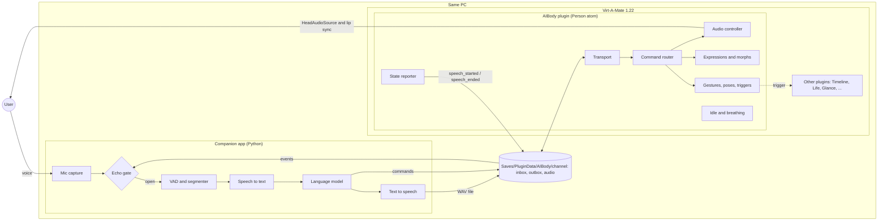

# AIBody: a virtual body for an AI in Virt-A-Mate

AIBody gives an AI a body in [Virt-A-Mate](https://www.virtamate.com/) (VaM). The body hears the
user through the microphone, speaks with lip sync, shows facial expressions, makes gestures and
poses, and keeps moving (idle motion and breathing) while it waits.

The project has two parts:

- **VaM plugin** (`src/`, C# 6): the *body*. A small `MVRScript` on a Person atom that plays speech
  audio, drives morphs, gestures and poses, and reports when it starts and stops speaking.
- **Companion app** (`companion/`, Python): the *brain*. It runs next to VaM on the same PC and does
  everything the VaM plugin sandbox does not allow: microphone capture, voice activity detection,
  speech to text, the language model and text to speech.

Status: **early skeleton (v0.1.0)**. The plugin compiles as C# 6 against API stubs but has not been
run inside VaM yet. The companion runs end to end with mock engines (no real STT, LLM or TTS yet).
See [Roadmap](#roadmap).

## Architecture



Flow of one turn:

1. The companion records the user, detects the end of the utterance (silence timeout) and
   transcribes it.
2. The language model answers with text plus an optional expression and gesture.
3. The companion synthesizes a WAV into the shared `audio/` folder and sends `expression`,
   `gesture` and `speak` commands.
4. The plugin plays the WAV through the Person's `HeadAudioSource`. VaM's built-in lip sync moves
   the mouth.
5. The plugin reports `speech_started` and `speech_ended`. The companion keeps the microphone closed
   in between (plus a short tail) so the AI does not hear and answer itself.

This is the same split that [Voxta](https://doc.voxta.ai/docs/integrations/vam) and
[VoiceControl2](https://github.com/StyleMavin/VoiceControl2) +
[VoskCompanion](https://github.com/StyleMavin/VoskCompanion) use: a thin client inside VaM and the
heavy work in a separate program.

## Repository layout

```
src/                     VaM plugin (C# 6). Entry: AIBody.cslist
  AIBodyPlugin.cs          MVRScript: settings, UI, frame loop, wiring
  ITransport.cs            transport interface
  FileTransport.cs         JSON files in Saves/PluginData (works without network access)
  HttpTransport.cs         polls the companion's local HTTP server (needs network access)
  Protocol.cs              message types and helpers
  CommandRouter.cs         dispatches commands, sends ack / error events
  AudioController.cs       loads WAVs via URLAudioClipManager, plays on HeadAudioSource
  StateReporter.cs         speech_started / speech_ended events
  MorphHelper.cs           morph lookup and smooth blending layer
  ExpressionController.cs  expression presets (built-in + expressions.json)
  PoseController.cs        poses, gestures.json, Timeline and generic triggers
  IdleController.cs        idle head sway and head gestures (nod, shake, tilt)
  BreathingController.cs   procedural breathing on a chest morph
protocol/                PROTOCOL.md and JSON schemas for commands and events
companion/               Python companion app (stdlib only for the core)
  aibody_companion/        transport, audio (capture, VAD, echo gate), pipeline (STT, LLM, TTS)
  tests/                   unit tests (python -m unittest)
examples/                example commands, expressions.json, gestures.json
packaging/meta.json      VaM package metadata
tools/                   build_var.py (package), check_plugin.sh + stubs (compile check)
```

## Setup

### Requirements

- Virt-A-Mate **1.22** (VaM 1.x). VaM 2 does not support plugins yet.
- Windows PC that runs VaM, Python 3.10+ for the companion.

### Install the plugin

Option A, as a package:

```
python tools/build_var.py          # creates dist/d0n.AIBody.1.var
```

Copy the `.var` into `<VaM>/AddonPackages/`.

Option B, as loose files (handy while developing): copy everything in `src/` to
`<VaM>/Custom/Scripts/d0n/AIBody/`. VaM recompiles when you reload the plugin.

Then in VaM:

1. Select a Person atom, open **Plugins**, **Add Plugin** and choose
   `Custom/Scripts/d0n/AIBody/AIBody.cslist` (from the package if you used option A).
2. Open the plugin's **Open Custom UI**. The status box shows the transport, the shared folder and
   whether audio and morphs were found.
3. Keep the Person's **Auto Behaviors > Lip Sync** enabled. It animates the mouth from the audio.
4. Optional: copy `examples/expressions.json` and `examples/gestures.json` to
   `<VaM>/Saves/PluginData/AIBody/` and adjust them, then press
   **Reload expressions / gestures**.

### Choose a transport

| Transport | VaM setting needed | Notes |
|-----------|--------------------|-------|
| File (default) | none | Commands and events are JSON files in `Saves/PluginData/AIBody/<channel>/`. ~0.1 s latency. |
| HTTP | **Allow Plugins Network Access** | The plugin polls `http://127.0.0.1:8765`. |

To use HTTP, enable network access for plugins in VaM's **User Preferences > Security** tab
("Allow Plugins Network Access"; it is off by default), then pick
"HTTP (needs network access)" in the plugin and start the companion with `--transport http`.
Audio files always go through the shared folder, so the companion needs the VaM path either way.

The **Channel** setting (default: the atom's name, e.g. `Person`) must match the companion's
`--channel`. Use one channel per Person atom if you want several AIs in one scene.

### Run the companion

```
cd companion
python -m aibody_companion --vam-root "C:/VaM" --channel Person            # type messages
pip install sounddevice
python -m aibody_companion --vam-root "C:/VaM" --channel Person --mode voice # use the mic
```

Or copy `config.example.json` to `config.json`, edit it and run
`python -m aibody_companion --config config.json`. With the mock engines the character answers
"You said: ..." with a humming tone, which is enough to test lip sync, expressions, gestures and
echo gating. Put API keys for real engines in environment variables, never in the repository.

Tests and checks:

```
cd companion && python -m unittest discover -s tests -t .
tools/check_plugin.sh              # needs the .NET SDK; compiles src/ as C# 6 against stubs
```

## Plugin sandbox limits

VaM compiles plugins itself (C# 6, Mono, .NET 3.5 profile) and runs them in a sandbox:

- **No `System.IO`.** File access goes through `MVR.FileManagementSecure.FileManagerSecure`.
  Writing is limited to `Saves/PluginData` (and `Custom/PluginData`). There is no reliable rename,
  so the plugin writes event files in place and the companion tolerates partial files.
- **No native DLLs, no `System.Diagnostics.Process`.** The plugin cannot start the companion or
  load speech engines. That is why the brain is a separate app.
- **Network only with permission.** Without "Allow Plugins Network Access", HTTP requests fail.
  Raw sockets are not used. The file transport works in every case.
- **C# 6 only.** No tuples, `out var`, pattern matching or other C# 7+ features. `check_plugin.sh`
  enforces this.
- **Microphone inside VaM is unconfirmed.** Whether Unity's `Microphone` class is usable from a
  plugin is not verified, so capture lives in the companion.

## Protocol summary

Full spec: [protocol/PROTOCOL.md](protocol/PROTOCOL.md). Every message is a JSON object with
`v`, `type`, `id` and `ts`.

Commands (companion to plugin): `ping`, `speak`, `stop_speaking`, `expression`, `set_morphs`,
`reset_morphs`, `gesture`, `pose`, `trigger`, `idle`, `breathing`.

Events (plugin to companion): `ready`, `heartbeat`, `pong`, `ack`, `error`, `speech_started`,
`speech_ended`, `gesture_done`, `shutdown`.

Example:

```json
{ "v": 1, "type": "speak", "id": "utt-0001",
  "audio": "Saves/PluginData/AIBody/Person/audio/utt-0001.wav",
  "text": "Hello, nice to meet you!", "expression": "happy" }
```

## Reusing other plugins

AIBody keeps its own motion simple and is meant to work alongside established plugins on the same
atom. The `trigger` command and `gestures.json` (`kind: timeline` or `trigger`) can call actions and
set parameters on any of them.

| Plugin | Use for | Link |
|--------|---------|------|
| Timeline (Acid Bubbles) | keyframe animations for gestures and idle loops; "Play &lt;name&gt;" actions | [Hub](https://hub.virtamate.com/resources/timeline.94/), [wiki](https://hub.virtamate.com/resources/timeline-3-wiki.860/), [GitHub](https://github.com/acidbubbles/vam-timeline) |
| Life (MacGruber) | realistic breathing with chest movement and sounds, Gaze head motion | [Hub](https://hub.virtamate.com/resources/life.165/) |
| Glance (Acid Bubbles) | natural eye movement driven by head motion | [Hub](https://hub.virtamate.com/resources/glance-realistic-head-driven-eye-motion.5461/), [GitHub](https://github.com/acidbubbles/vam-glance) |
| E-Motion (VRAdultFun) | expressions and idle reactions from personality presets | VaMHub, search "E-Motion" |
| Naturalis (everlaster) | breast and glute physics | VaMHub, search "Naturalis" |
| Voxta (Acid Bubbles) | reference for the thin-client design, state triggers, echo handling | [docs](https://doc.voxta.ai/docs/integrations/vam) |
| VoiceControl2 + VoskCompanion | reference for a plugin talking to an external speech app | [plugin](https://github.com/StyleMavin/VoiceControl2), [companion](https://github.com/StyleMavin/VoskCompanion) |
| SpeechRecognition | in-VaM Windows speech recognition (legacy, breaks with Windows updates) | VaMHub |
| Embody, Dev Tools (Acid Bubbles) | code to study for VaM plugin patterns | [Embody](https://github.com/acidbubbles/vam-embody), [Dev Tools](https://github.com/acidbubbles/vam-devtools) |

Poses from VaMHub can be loaded with the `pose` command using the usual package path, for example
`Author.Package.1:/Custom/Atom/Person/Pose/name.vap`.

## Roadmap

1. **Test inside VaM 1.22** and fix every `TODO(verify)` in `src/` (audio clip loading, pose
   preset loading, Timeline action names, editable text fields, morph names).
2. **Real engines** in the companion: STT (faster-whisper or Vosk), LLM (local server such as
   Ollama, or a cloud API), TTS (Piper or XTTS). Run them on a worker thread.
3. **Better VAD** (webrtcvad or Silero) and **barge-in** with acoustic echo cancellation, so the
   user can interrupt.
4. **States** (idle, listening, thinking, speaking) as plugin triggers, like Voxta, so scene
   builders can attach Timeline animations without code.
5. **Gaze and attention**: look at the user's camera while listening (or hand off to Glance).
6. Viseme-based lip sync from TTS timing data, as an alternative to VaM's audio lip sync.
7. Publish a `.var` on VaMHub.

## License

[LGPL-2.1](LICENSE).
