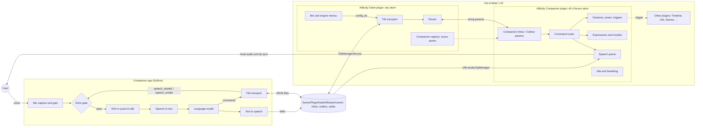

# AIBody: a virtual body for an AI in Virt-A-Mate

AIBody gives an AI a body in [Virt-A-Mate](https://www.virtamate.com/) (VaM). The body hears the
user through the microphone, speaks with lip sync, shows facial expressions, makes gestures and
poses, and keeps moving (idle motion and breathing) while it waits.

The project has three parts. **All of them are needed together:**

- **AIBody Client plugin** (`src/Client/`): the *controlling side*. Loaded on any atom, typically
  the user's own Person atom or an Empty. It talks to the companion app through a shared folder,
  sends heartbeats and status, holds the microphone/push-to-talk and engine menus, finds the
  Companion plugin in the scene and forwards body commands to it.
- **AIBody Companion plugin** (`src/Companion/`): the *body the AI drives*. Loaded on the AI
  character's Person atom. It plays speech audio with lip sync, drives morphs, expressions,
  gestures and poses, and reports when it starts and stops speaking. It accepts commands only
  from a Client plugin. Its settings (volume, idle, breathing, ...) are saved with the Person.
- **Companion app** (`companion/`, Python): the *brain*. It runs next to VaM and does everything
  the VaM plugin sandbox does not allow: microphone capture, voice activity detection, speech to
  text, the language model and text to speech.

Both plugins ship in **one package**, `d0n.AIBody.2.var`.

> **Naming.** "Companion plugin" is the VaM plugin on the AI's character. "Companion app" (the
> Python program in `companion/`, also called the bridge) is the separate program outside VaM.
> They are different things and both are required.

Status: **early (v0.5.0)**. Both plugins compile as C# 6 against API stubs but have not been run
inside VaM yet; every unverified VaM/Unity call is marked `TODO(verify)` in the code. The
companion app runs end to end with mock engines (no real STT, LLM or TTS yet). See
[Roadmap](#roadmap).

## Architecture



Flow of one turn:

1. The companion app records the user (voice activation or push-to-talk), detects the end of the
   utterance (silence timeout) and transcribes it.
2. The language model answers with text plus an optional expression and gesture.
3. The companion app writes a WAV into `Saves/PluginData/AIBody/<channel>/audio/` and drops
   `expression`, `gesture` and `speak` commands into the channel's `inbox/`.
4. The Client plugin picks them up and hands them to one Companion plugin (see below).
5. The Companion plugin loads the clip with VaM's `URLAudioClipManager`, queues it and plays it
   through the character's head audio source. VaM's built-in lip sync moves the mouth.
6. The Companion plugin reports `speech_started` and `speech_ended` from actual playback; the
   Client forwards them. The companion app keeps the microphone closed in between (plus a short
   tail) so the AI does not hear and answer itself.

This is the same split that [Voxta](https://doc.voxta.ai/docs/integrations/vam) and
[VoiceControl2](https://github.com/StyleMavin/VoiceControl2) +
[VoskCompanion](https://github.com/StyleMavin/VoskCompanion) use: a thin client inside VaM and the
heavy work in a separate program.

### How the two plugins talk

VaM compiles each plugin separately, so the plugins cannot call each other's C# code. They use
only VaM's public scene API (no files, no network):

- The Companion plugin registers the string params `AIBody Companion Inbox`,
  `AIBody Companion Outbox` and `AIBody Companion Version`.
- Once per second the Client scans the scene's atoms for these params. New or removed
  Companions and scene changes are picked up automatically.
- Commands: the Client writes one command JSON into the Inbox, marked as coming from a Client
  (`via`, `client`). The Companion handles it right away, clears the value and refuses anything
  not marked that way (`not_from_client`) or coming from a second Client (`client_conflict`).
- Events: the Companion appends to a JSON array in its Outbox; the Client drains it every frame
  and forwards the events with the atom name.
- Routing: the command's `atom` if given, else the Client's **Companion atom** setting, else the
  only Companion in the scene. If the target is missing or ambiguous the companion app gets an
  `error` (`no_companion`, `companion_conflict`) and **nothing is redirected to another atom**.

Details: [protocol/PROTOCOL.md](protocol/PROTOCOL.md#routing-client-plugin---companion-plugin).

## Repository layout

```
src/                       VaM plugins (C# 6)
  Shared/                    Log.cs, Protocol.cs: written once in namespace AIBodyShared,
                             renamed per plugin at build time (AIBodyClientShared / AIBodyCompanionShared)
  Client/
    AIBodyClient.cslist        Client plugin entry
    AIBodyClient.cs            MVRScript: transport, channel, engine menus, status, routing
    CompanionRegistry.cs       finds Companion plugins, inbox/outbox bridge
    FileTransport.cs           JSON files in Saves/PluginData via FileManagerSecure
    ITransport.cs              transport interface
    MicConfig.cs               microphone menu, device list, push-to-talk, level meter
  Companion/
    AIBodyCompanion.cslist     Companion plugin entry
    AIBodyCompanion.cs         MVRScript: settings, inbox/outbox, sender check, status
    CommandRouter.cs           dispatches body commands, ack / error events
    SpeechPlayer.cs            speech queue: file path via URLAudioClipManager, playback, events
    MorphHelper.cs             morph lookup and smooth blending layer
    ExpressionController.cs    expression presets (built-in + expressions.json)
    PoseController.cs          poses, gestures.json, Timeline and generic triggers
    IdleController.cs          idle head sway and head gestures (nod, shake, tilt)
    BreathingController.cs     procedural breathing on a chest morph
  Optional/                  HTTP transport (UnityWebRequest), NOT in the package
legacy/v0.4/               old Session/Person/Person2 plugins (not built, not shipped)
protocol/                  PROTOCOL.md and JSON schemas
companion/                 Python companion app (stdlib only for the core)
  aibody_companion/
    transport/               file transport (default), optional HTTP server, auto
    audio/                   capture + device control, mic settings, input processor, VAD, echo gate
    pipeline/                STT, LLM, TTS interfaces and mock engines
    orchestrator.py          ties it all together (tick loop, Companion tracking, heartbeat)
  tests/                     unit and end-to-end tests (python -m unittest)
examples/                  example commands and events, expressions.json, gestures.json
packaging/                 meta.json (shared) + AIBody.json (package overrides)
tools/                     assemble_plugins.py (plugin folders), build_var.py (package),
                           check_plugin.sh/.py + stubs (sandbox, identity and compile check)
```

## Setup

### Requirements

- Virt-A-Mate **1.22** (VaM 1.x). VaM 2 does not support plugins yet.
- Windows PC that runs VaM, Python 3.10+ for the companion app, a microphone.
- No "Allow Plugins Network Access" needed: the default build uses no network code.

### Install the package

Download `d0n.AIBody.2.var` from the [releases](https://github.com/d0n/vam_plugin/releases), or
build it:

```
python tools/build_var.py    # dist/d0n.AIBody.2.var
```

Copy it into VaM's `AddonPackages` folder:

```
<VaM>/AddonPackages/d0n.AIBody.2.var
```

Remove the older AIBody packages: `d0n.AIBody.1.var`, `d0n.AIBodySession.*.var`,
`d0n.AIBodyPerson.*.var` and `d0n.AIBodyPerson2.*.var`. They are replaced by this one.

Contents:

```
d0n.AIBody.2.var
├── meta.json
└── Custom/Scripts/d0n/AIBody/
    ├── Client/
    │   ├── AIBodyClient.cslist
    │   ├── Shared/Log.cs, Shared/Protocol.cs
    │   └── ITransport.cs, FileTransport.cs, CompanionRegistry.cs, MicConfig.cs, AIBodyClient.cs
    └── Companion/
        ├── AIBodyCompanion.cslist
        ├── Shared/Log.cs, Shared/Protocol.cs
        └── MorphHelper.cs, SpeechPlayer.cs, ExpressionController.cs, BreathingController.cs,
            IdleController.cs, PoseController.cs, CommandRouter.cs, AIBodyCompanion.cs
```

Then in VaM (if VaM asks whether to enable plugins from this package, allow it):

1. **Client plugin:** select any atom, e.g. your own Person atom or an Empty > **Plugins** tab >
   **Add Plugin** > choose
   `AddonPackages > d0n.AIBody.2:/Custom/Scripts/d0n/AIBody/Client/AIBodyClient.cslist`.
   Use one Client per scene.
2. **Companion plugin:** select the AI character's Person atom > **Plugins** tab > **Add Plugin** >
   choose `AddonPackages > d0n.AIBody.2:/Custom/Scripts/d0n/AIBody/Companion/AIBodyCompanion.cslist`.
3. Keep the AI character's **Auto Behaviors > Lip Sync** enabled. It animates the mouth from the
   audio.
4. With more than one Companion in the scene, pick the one the AI speaks through in the Client's
   **Companion atom**, or with the companion app's `target_atom` / `--atom`, or `@<atom> ...`
   for one typed line.
5. Save the scene to keep the plugins and their settings.
6. Optional: copy `examples/expressions.json` and `examples/gestures.json` to
   `<VaM>/Saves/PluginData/AIBody/` and adjust them, then press **Reload expressions / gestures**
   in the Companion plugin.
7. Start the companion app (below). The Client's status shows "Companion app: connected".

Loose files instead of the package (handy while developing):

```
python tools/assemble_plugins.py --out "<VaM>/Custom/Scripts/d0n/AIBody"
```

This writes `Client/` and `Companion/` with the per-plugin `Shared/` copies. Then pick
`Custom/Scripts/d0n/AIBody/Client/AIBodyClient.cslist` and
`Custom/Scripts/d0n/AIBody/Companion/AIBodyCompanion.cslist`. Do not copy `src/` directly: the
shared files must be renamed per plugin. Use either the package or the loose files, not both.

### Client plugin settings

- **Active**, **Transport** (only "File (shared folder)" in the default build), **Channel**
  (default `default`; must match the companion app's `channel`), **File poll interval**.
- **Companion atom**: which Companion gets commands that name no `atom`; default
  "(auto: the only one in the scene)". **Rescan companions** forces a scan.
- **Speech-to-text**, **Language model**, **Text-to-speech**: engine menus, filled from the
  companion app's list of available engines and sent with the settings.
- Status box: companion app connection, the Companions found and where commands go.
  **Reconnect**, **Stop all speech** (every Companion).

### Microphone menu (Client plugin)

The microphone is captured by the companion app, but configured in the Client plugin. Settings
are applied live (0.3 s after the last change) and are saved with the Client plugin:

- **Mic enabled**, **Mic mode** (Voice activation / Push-to-talk), **Mic device** (list reported
  by the companion app; **Refresh mic devices** asks again)
- **VAD threshold** (RMS level that counts as speech), **Input gain**, **Silence timeout**,
  **Min / Max utterance**, **Echo gate tail**
- **Push-to-talk active** toggle, plus the actions *Push-to-talk start / stop / toggle* for
  scene triggers or key bindings, and **Push-to-talk interrupts speech**
- **Show level meter**: a text meter (`[|||||....!.....] -32 dB`, `!` marks the threshold), the
  current mic state and whether the companion app accepted the settings

### Companion plugin settings

**Speech volume**, **Idle head motion** and **Idle intensity**, **Breathing**, **Breaths per
minute**, **Breath depth**, **Breath morph**, **Verbose log**. Actions: **Stop speaking**,
**Reset expression**, **Reload config files** (button: *Reload expressions / gestures*). The
status box shows whether a Client plugin is draining its events and which one drives it, the
speech queue and missing morphs or audio source. Gaze is not part of AIBody yet; use
[Glance](https://hub.virtamate.com/resources/glance-realistic-head-driven-eye-motion.5461/) on the
same atom.

### Run the companion app

```
cd companion
pip install sounddevice                                   # microphone support
python -m aibody_companion --list-devices                 # check the microphone
python -m aibody_companion --vam-root "C:/VaM"            # file transport, channel "default"
```

Options: `--channel` (default `default`), `--atom <uid>` (atom with the Companion plugin the AI
speaks through; default: the Client's choice), `--no-mic` (text only), `--no-stdin`,
`--config config.json` (see `config.example.json`, including initial `mic` settings).
`--transport http|auto` only works with the optional HTTP build (below). Typed lines on stdin make
the body speak (`@Person#2 Hallo` addresses one atom), which is handy for testing without a
microphone. With the mock engines the character answers "You said: ..." with a humming tone,
enough to test lip sync, expressions, gestures, queueing and echo gating. Put API keys for real
engines in environment variables, never in the repository.

Tests and checks:

```
cd companion && python -m unittest discover -s tests -t .
tools/check_plugin.sh      # needs the .NET SDK: sandbox scan, identity check, compiles both plugins (C# 6)
```

## Plugin sandbox limits

VaM compiles plugins itself (C# 6, Mono, .NET 3.5 profile) and runs them in a sandbox. A plugin
that uses a blocked API does not load at all, so the default build avoids all of them and
`tools/check_plugin.sh` enforces it (it scans both assembled plugins and compiles them without any
networking stubs, separately and together to rule out duplicate type names):

- **No `System.IO`.** File access goes through `MVR.FileManagementSecure.FileManagerSecure`.
  Writing is limited to `Saves/PluginData`. There is no reliable rename, so the Client plugin
  writes event files in place and the companion app tolerates partial files.
- **No native DLLs, no `System.Diagnostics.Process`, no reflection.** The plugins cannot start
  the companion app or load speech engines. That is why the brain is a separate app.
- **No `UnityEngine.Networking` / `UnityWebRequest`** in the default build. The companion app link
  is the shared folder; speech audio is loaded from a local file path with VaM's own
  `URLAudioClipManager` (`TODO(verify)` on 1.22).
- **C# 6 only.** No tuples, `out var`, pattern matching or other C# 7+ features.
- **Microphone inside VaM is unverified**, so capture and device listing live in the companion app.

### Optional HTTP build (not in the package)

`src/Optional/HttpTransport.cs` and `AutoTransport.cs` (HTTP long-poll with file fallback, needs
"Allow Plugins Network Access") are wrapped in `#if AIBODY_HTTP` and never packaged. To try them
with loose files:

```
python tools/assemble_plugins.py --http --out "<VaM>/Custom/Scripts/d0n/AIBody"
```

and run the companion app with `--transport auto`. This may not load on sandboxed VaM 1.22
installs.

## Protocol summary

Full spec: [protocol/PROTOCOL.md](protocol/PROTOCOL.md) (version 2). Every message is a JSON
object with `v`, `type`, `id` and `ts`; body commands may carry `atom`.

Companion app to VaM: body commands `speak`, `stop_speaking`, `expression`, `set_morphs`,
`reset_morphs`, `gesture`, `pose`, `trigger`, `idle`, `breathing` (forwarded to one Companion
plugin); `ping`, `companion_heartbeat`, and for the microphone menu `config_ack`, `devices`,
`mic_state`, `mic_level` (Client plugin).

VaM to companion app: from the Client plugin `ready`, `heartbeat`, `pong`, `companions`, `config`,
`ptt`, `list_devices`, `shutdown`, `error`; from the Companion plugin (with `atom`)
`companion_status`, `speech_started`, `speech_ended`, `gesture_done`, `ack`, `error`.

Example:

```json
{ "v": 2, "type": "speak", "id": "utt-0001", "atom": "Person",
  "audio": "Saves/PluginData/AIBody/default/audio/utt-0001.wav",
  "text": "Hello, nice to meet you!", "expression": "happy", "queue": "append" }
```

### Earlier versions

v0.2 shipped one plugin (`d0n.AIBody.1.var`), v0.3/v0.4 a Session plugin plus Person/Person2
plugins with character slots (protocol v1). Their sources are kept in [legacy/v0.4](legacy/v0.4)
for reference; use the `v0.4.0-session` tag for a buildable tree.

## Reusing other plugins

AIBody keeps its own motion simple and is meant to work alongside established plugins on the same
atom. The `trigger` command and `gestures.json` (`kind: timeline` or `trigger`) can call actions and
set parameters on any of them.

| Plugin | Use for | Link |
|--------|---------|------|
| Timeline (Acid Bubbles) | keyframe animations for gestures and idle loops; "Play &lt;name&gt;" actions | [Hub](https://hub.virtamate.com/resources/timeline.94/), [wiki](https://hub.virtamate.com/resources/timeline-3-wiki.860/), [GitHub](https://github.com/acidbubbles/vam-timeline) |
| Life (MacGruber) | realistic breathing with chest movement and sounds, Gaze head motion | [Hub](https://hub.virtamate.com/resources/life.165/) |
| Glance (Acid Bubbles) | natural eye movement driven by head motion | [Hub](https://hub.virtamate.com/resources/glance-realistic-head-driven-eye-motion.5461/), [GitHub](https://github.com/acidbubbles/vam-glance) |
| E-Motion (VRAdultFun) | expressions and idle reactions from personality presets | VaMHub, search "E-Motion" |
| Naturalis (everlaster) | breast and glute physics | VaMHub, search "Naturalis" |
| Voxta (Acid Bubbles) | reference for the thin-client design, state triggers, echo handling | [docs](https://doc.voxta.ai/docs/integrations/vam) |
| VoiceControl2 + VoskCompanion | reference for a plugin talking to an external speech app | [plugin](https://github.com/StyleMavin/VoiceControl2), [companion](https://github.com/StyleMavin/VoskCompanion) |
| SpeechRecognition | in-VaM Windows speech recognition (legacy, breaks with Windows updates) | VaMHub |
| Embody, Dev Tools (Acid Bubbles) | code to study for VaM plugin patterns | [Embody](https://github.com/acidbubbles/vam-embody), [Dev Tools](https://github.com/acidbubbles/vam-devtools) |

Poses from VaMHub can be loaded with the `pose` command using the usual package path, for example
`Author.Package.1:/Custom/Atom/Person/Pose/name.vap`.

## Roadmap

1. **Test inside VaM 1.22** and fix every `TODO(verify)` in `src/`: that the package loads in
   the sandbox with both plugins at once, `.cslist` subfolder paths inside a `.var`, the
   Client/Companion bridge (atom scan, `plugin#` storable ids, cross-plugin param callbacks),
   `URLAudioClipManager` path loading and `PlayNow` playback (lip sync), pose preset loading,
   Timeline action names, editable text fields, chooser updates, morph names.
2. **Real engines** in the companion: STT (faster-whisper or Vosk), LLM (local server such as
   Ollama, or a cloud API), TTS (Piper or XTTS). Run them on a worker thread and stream
   sentence by sentence into the speech queue.
3. **Better VAD** (webrtcvad or Silero) and **barge-in** in voice-activation mode with acoustic
   echo cancellation.
4. **States** (idle, listening, thinking, speaking) as plugin triggers, like Voxta, so scene
   builders can attach Timeline animations without code.
5. **Gaze and attention** in the Companion plugin: look at the user's camera while listening (for
   now use Glance).
6. Two AIs at once (one LLM persona per Companion atom).
7. Viseme-based lip sync from TTS timing data, as an alternative to VaM's audio lip sync.
8. Publish the packages on VaMHub.

## License

[LGPL-2.1](LICENSE).
