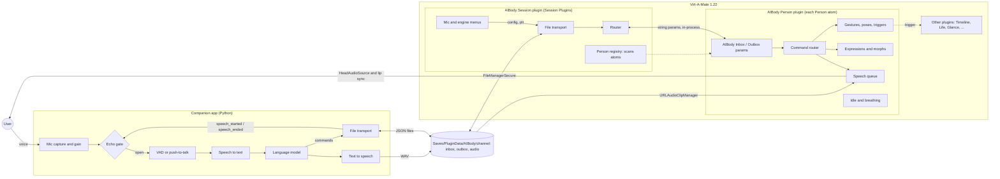

# AIBody: a virtual body for an AI in Virt-A-Mate

AIBody gives an AI a body in [Virt-A-Mate](https://www.virtamate.com/) (VaM). The body hears the
user through the microphone, speaks with lip sync, shows facial expressions, makes gestures and
poses, and keeps moving (idle motion and breathing) while it waits.

The project has three parts. **All three are needed together.**

- **AIBody Session plugin** (`src/Session/`, package `d0n.AIBodySession`): the *connection*.
  Loaded once in VaM's **Session Plugins**, so it survives scene changes. It talks to the
  companion through a shared folder, holds the microphone and engine menus and shows the
  connection status. It forwards body commands to the Person plugins in the scene.
- **AIBody Person plugin** (`src/Person/`, package `d0n.AIBodyPerson`): the *body*. Loaded on a
  Person atom's **Plugins** tab (one per character). It plays speech audio with lip sync, drives
  morphs, expressions, gestures and poses, and reports when it starts and stops speaking. Its
  settings (volume, idle, breathing, ...) are saved with the Person.
- **Companion app** (`companion/`, Python): the *brain*. It runs next to VaM and does everything
  the VaM plugin sandbox does not allow: microphone capture, voice activity detection, speech to
  text, the language model and text to speech.

Status: **early (v0.3.0)**. Both plugins compile as C# 6 against API stubs but have not been run
inside VaM yet; every unverified VaM/Unity call is marked `TODO(verify)` in the code. The
companion runs end to end with mock engines (no real STT, LLM or TTS yet). See
[Roadmap](#roadmap).

## Architecture



Flow of one turn:

1. The companion records the user (voice activation or push-to-talk), detects the end of the
   utterance (silence timeout) and transcribes it.
2. The language model answers with text plus an optional expression and gesture.
3. The companion writes a WAV into `Saves/PluginData/AIBody/<channel>/audio/` and drops
   `expression`, `gesture` and `speak` commands into the channel's `inbox/`, addressed to a
   Person atom (`atom` field).
4. The Session plugin picks them up and hands them to the Person plugin on that atom.
5. The Person plugin loads the clip with VaM's `URLAudioClipManager`, queues it and plays it
   through the Person's head audio source. VaM's built-in lip sync moves the mouth.
6. The Person plugin reports `speech_started` and `speech_ended` from actual playback; the
   Session plugin forwards them. The companion keeps the microphone closed in between (plus a
   short tail) so the AI does not hear and answer itself.

This is the same split that [Voxta](https://doc.voxta.ai/docs/integrations/vam) and
[VoiceControl2](https://github.com/StyleMavin/VoiceControl2) +
[VoskCompanion](https://github.com/StyleMavin/VoskCompanion) use: a thin client inside VaM and the
heavy work in a separate program.

### How the two plugins talk

VaM compiles each plugin separately, so the plugins cannot call each other's C# code. They use
only VaM's public scene API (no files, no network):

- The Person plugin registers the string params **AIBody Inbox**, **AIBody Outbox** and
  **AIBody Person Version**.
- Once per second the Session plugin scans the scene's atoms for a plugin with these params. New
  or removed characters and scene changes are picked up automatically.
- Commands: the Session plugin writes one command JSON into *AIBody Inbox*; the Person plugin
  handles it right away and clears the value.
- Events: the Person plugin appends to a JSON array in *AIBody Outbox*; the Session plugin drains
  it every frame and forwards the events with the atom's name.
- Routing: a body command goes to the atom in its `atom` field, else to the Session plugin's
  **Default character**, else to the first Person plugin found. Without any Person plugin the
  companion gets an `error` with code `no_person`.

Details: [protocol/PROTOCOL.md](protocol/PROTOCOL.md#routing-session-plugin---person-plugins).

## Repository layout

```
src/                       VaM plugins (C# 6)
  AIBodySession.cslist       Session plugin entry (Session Plugins)
  AIBodyPerson.cslist        Person plugin entry (Person atom > Plugins)
  Shared/                    Log.cs, Protocol.cs (message types, bridge param names); in both packages
  Session/
    AIBodySession.cs           MVRScript: transport, channel, engine menus, status, routing
    PersonRegistry.cs          finds Person plugins in the scene, inbox/outbox bridge
    FileTransport.cs           JSON files in Saves/PluginData via FileManagerSecure
    ITransport.cs              transport interface
    MicConfig.cs               microphone menu, device list, push-to-talk, level meter
  Person/
    AIBodyPerson.cs            MVRScript: per-character settings, inbox/outbox, status
    CommandRouter.cs           dispatches body commands, ack / error events
    SpeechPlayer.cs            speech queue: file path via URLAudioClipManager, playback, events
    MorphHelper.cs             morph lookup and smooth blending layer
    ExpressionController.cs    expression presets (built-in + expressions.json)
    PoseController.cs          poses, gestures.json, Timeline and generic triggers
    IdleController.cs          idle head sway and head gestures (nod, shake, tilt)
    BreathingController.cs     procedural breathing on a chest morph
  Optional/                  HTTP transport (UnityWebRequest), NOT in any .cslist or package
protocol/                  PROTOCOL.md and JSON schemas
companion/                 Python companion app (stdlib only for the core)
  aibody_companion/
    transport/               file transport (default), optional HTTP server, auto
    audio/                   capture + device control, mic settings, input processor, VAD, echo gate
    pipeline/                STT, LLM, TTS interfaces and mock engines
    orchestrator.py          ties it all together (tick loop, person routing, heartbeat)
  tests/                     unit and end-to-end tests (python -m unittest)
examples/                  example commands and events, expressions.json, gestures.json
packaging/                 meta.json (shared) + AIBodySession.json / AIBodyPerson.json overrides
tools/                     build_var.py (packages), check_plugin.sh/.py + stubs (sandbox + compile check)
```

## Setup

### Requirements

- Virt-A-Mate **1.22** (VaM 1.x). VaM 2 does not support plugins yet.
- Windows PC that runs VaM, Python 3.10+ for the companion, a microphone.
- No "Allow Plugins Network Access" needed: the default build uses no network code.

### Install the two packages

Download `d0n.AIBodySession.1.var` and `d0n.AIBodyPerson.1.var` from the
[releases](https://github.com/d0n/vam_plugin/releases), or build them:

```
python tools/build_var.py          # creates dist/d0n.AIBodySession.1.var and dist/d0n.AIBodyPerson.1.var
```

Copy both files into VaM's `AddonPackages` folder:

```
<VaM>/AddonPackages/d0n.AIBodySession.1.var
<VaM>/AddonPackages/d0n.AIBodyPerson.1.var
```

Contents of the packages:

```
d0n.AIBodySession.1.var
├── meta.json
└── Custom/Scripts/d0n/AIBody/
    ├── AIBodySession.cslist
    ├── Shared/Log.cs, Shared/Protocol.cs
    └── Session/ITransport.cs, FileTransport.cs, PersonRegistry.cs, MicConfig.cs, AIBodySession.cs

d0n.AIBodyPerson.1.var
├── meta.json
└── Custom/Scripts/d0n/AIBody/
    ├── AIBodyPerson.cslist
    ├── Shared/Log.cs, Shared/Protocol.cs
    └── Person/MorphHelper.cs, SpeechPlayer.cs, ExpressionController.cs, BreathingController.cs,
               IdleController.cs, PoseController.cs, CommandRouter.cs, AIBodyPerson.cs
```

Then in VaM (if VaM asks whether to enable plugins from these packages, allow it):

1. **Session plugin, once:** Main UI > **Session Plugins** > **Add Plugin** > choose
   `AddonPackages > d0n.AIBodySession.1:/Custom/Scripts/d0n/AIBody/AIBodySession.cslist`.
   Optional: **Set Current As User Defaults** in the session plugin presets, so it loads with
   every VaM start. It stays loaded across scene changes.
2. **Person plugin, per character:** select the Person atom > **Plugins** tab > **Add Plugin** >
   choose `AddonPackages > d0n.AIBodyPerson.1:/Custom/Scripts/d0n/AIBody/AIBodyPerson.cslist`.
   Save the scene to keep it and its settings with the character.
3. Keep the Person's **Auto Behaviors > Lip Sync** enabled. It animates the mouth from the audio.
4. With several characters, pick the one the AI speaks through in the Session plugin's
   **Default character** (or set `default_atom` / `--atom` in the companion).
5. Optional: copy `examples/expressions.json` and `examples/gestures.json` to
   `<VaM>/Saves/PluginData/AIBody/` and adjust them, then press **Reload expressions / gestures** in the
   Person plugin.

Loose files instead of packages (handy while developing): copy `src/AIBodySession.cslist`,
`src/AIBodyPerson.cslist`, `src/Shared/`, `src/Session/` and `src/Person/` to
`<VaM>/Custom/Scripts/d0n/AIBody/` (do not copy `src/Optional/`) and pick
`Custom/Scripts/d0n/AIBody/AIBodySession.cslist` and `.../AIBodyPerson.cslist` in the same places.
Use either the packages or the loose files, not both.

### Session plugin settings

- **Active**, **Transport** (only "File (shared folder)" in the default build), **Channel**
  (default `default`; must match the companion's `channel`), **File poll interval**.
- **Default character**: Person atom for commands without `atom` ("(first Person found)" by
  default). **Rescan characters** forces a scan.
- **Speech-to-text**, **Language model**, **Text-to-speech**: engine menus, filled from the
  companion's list of available engines and sent with the settings.
- Status box: companion connection, characters found, last error. **Reconnect**,
  **Stop all speech**.

### Microphone menu (Session plugin)

The microphone is captured by the companion, but configured in the Session plugin. Settings are
applied by the companion live (0.3 s after the last change) and are kept in the session plugin
preset:

- **Mic enabled**, **Mic mode** (Voice activation / Push-to-talk), **Mic device** (list reported
  by the companion; **Refresh mic devices** asks again)
- **VAD threshold** (RMS level that counts as speech), **Input gain**, **Silence timeout**,
  **Min / Max utterance**, **Echo gate tail**
- **Push-to-talk active** toggle, plus the actions *Push-to-talk start / stop / toggle* for
  scene triggers or key bindings, and **Push-to-talk interrupts speech**
- **Show level meter**: a text meter (`[|||||....!.....] -32 dB`, `!` marks the threshold), the
  current mic state and whether the companion accepted the settings

### Person plugin settings

**Speech volume**, **Idle head motion** and **Idle intensity**, **Breathing**, **Breaths per
minute**, **Breath depth**, **Breath morph**, **Verbose log**. Actions: **Stop speaking**,
**Reset expression**, **Reload config files** (button: *Reload expressions / gestures*). The status box shows whether the Session plugin
is draining its events, the speech queue and missing morphs or audio source. Gaze is not part of
AIBody yet; use [Glance](https://hub.virtamate.com/resources/glance-realistic-head-driven-eye-motion.5461/)
on the same atom.

### Run the companion

```
cd companion
pip install sounddevice                                   # microphone support
python -m aibody_companion --list-devices                 # check the microphone
python -m aibody_companion --vam-root "C:/VaM"            # file transport, channel "default"
```

Options: `--channel` (default `default`), `--atom Person#2` (target character), `--no-mic`
(text only), `--no-stdin`, `--config config.json` (see `config.example.json`, including initial
`mic` settings). `--transport http|auto` only works with the optional HTTP build (below).
Typed lines on stdin make the body speak, which is handy for testing without a microphone. With
the mock engines the character answers "You said: ..." with a humming tone, enough to test lip
sync, expressions, gestures, queueing and echo gating. Put API keys for real engines in
environment variables, never in the repository.

Tests and checks:

```
cd companion && python -m unittest discover -s tests -t .
tools/check_plugin.sh      # needs the .NET SDK: sandbox scan + compiles each .cslist as C# 6 against stubs
```

## Plugin sandbox limits

VaM compiles plugins itself (C# 6, Mono, .NET 3.5 profile) and runs them in a sandbox. A plugin
that uses a blocked API does not load at all, so the default build avoids all of them and
`tools/check_plugin.sh` enforces it (it scans both `.cslist` file sets and compiles them without
any networking stubs):

- **No `System.IO`.** File access goes through `MVR.FileManagementSecure.FileManagerSecure`.
  Writing is limited to `Saves/PluginData`. There is no reliable rename, so the Session plugin
  writes event files in place and the companion tolerates partial files.
- **No native DLLs, no `System.Diagnostics.Process`, no reflection.** The plugins cannot start
  the companion or load speech engines. That is why the brain is a separate app.
- **No `UnityEngine.Networking` / `UnityWebRequest`** in the default build. The companion link is
  the shared folder; speech audio is loaded from a local file path with VaM's own
  `URLAudioClipManager` (`TODO(verify)` on 1.22).
- **C# 6 only.** No tuples, `out var`, pattern matching or other C# 7+ features.
- **Microphone inside VaM is unverified**, so capture and device listing live in the companion.

### Optional HTTP build (not in the packages)

`src/Optional/HttpTransport.cs` and `AutoTransport.cs` (HTTP long-poll with file fallback, needs
"Allow Plugins Network Access") are wrapped in `#if AIBODY_HTTP` and listed in no `.cslist`. To
try them with loose files: add `#define AIBODY_HTTP` as the first line of
`Session/AIBodySession.cs` and `Person/SpeechPlayer.cs`, add `Optional/HttpTransport.cs` and
`Optional/AutoTransport.cs` to `AIBodySession.cslist`, copy `Optional/` too, and run the
companion with `--transport auto`. This may not load on sandboxed VaM 1.22 installs.

## Protocol summary

Full spec: [protocol/PROTOCOL.md](protocol/PROTOCOL.md). Every message is a JSON object with
`v`, `type`, `id` and `ts`; body commands may carry `atom`.

Companion to VaM: body commands `speak`, `stop_speaking`, `expression`, `set_morphs`,
`reset_morphs`, `gesture`, `pose`, `trigger`, `idle`, `breathing` (forwarded to a Person
plugin); `ping`, `companion_heartbeat`, and for the microphone menu `config_ack`, `devices`,
`mic_state`, `mic_level` (Session plugin).

VaM to companion: from the Session plugin `ready`, `heartbeat`, `pong`, `persons`, `config`,
`ptt`, `list_devices`, `shutdown`, `error`; from Person plugins (with `atom`) `person_status`,
`speech_started`, `speech_ended`, `gesture_done`, `ack`, `error`.

Example:

```json
{ "v": 1, "type": "speak", "id": "utt-0001", "atom": "Person",
  "audio": "Saves/PluginData/AIBody/default/audio/utt-0001.wav",
  "text": "Hello, nice to meet you!", "expression": "happy", "queue": "append" }
```

## Reusing other plugins

AIBody keeps its own motion simple and is meant to work alongside established plugins on the same
atom. The `trigger` command and `gestures.json` (`kind: timeline` or `trigger`) can call actions and
set parameters on any of them.

| Plugin | Use for | Link |
|--------|---------|------|
| Timeline (Acid Bubbles) | keyframe animations for gestures and idle loops; "Play &lt;name&gt;" actions | [Hub](https://hub.virtamate.com/resources/timeline.94/), [wiki](https://hub.virtamate.com/resources/timeline-3-wiki.860/), [GitHub](https://github.com/acidbubbles/vam-timeline) |
| Life (MacGruber) | realistic breathing with chest movement and sounds, Gaze head motion | [Hub](https://hub.virtamate.com/resources/life.165/) |
| Glance (Acid Bubbles) | natural eye movement driven by head motion | [Hub](https://hub.virtamate.com/resources/glance-realistic-head-driven-eye-motion.5461/), [GitHub](https://github.com/acidbubbles/vam-glance) |
| E-Motion (VRAdultFun) | expressions and idle reactions from personality presets | VaMHub, search "E-Motion" |
| Naturalis (everlaster) | breast and glute physics | VaMHub, search "Naturalis" |
| Voxta (Acid Bubbles) | reference for the thin-client design, state triggers, echo handling | [docs](https://doc.voxta.ai/docs/integrations/vam) |
| VoiceControl2 + VoskCompanion | reference for a plugin talking to an external speech app | [plugin](https://github.com/StyleMavin/VoiceControl2), [companion](https://github.com/StyleMavin/VoskCompanion) |
| SpeechRecognition | in-VaM Windows speech recognition (legacy, breaks with Windows updates) | VaMHub |
| Embody, Dev Tools (Acid Bubbles) | code to study for VaM plugin patterns | [Embody](https://github.com/acidbubbles/vam-embody), [Dev Tools](https://github.com/acidbubbles/vam-devtools) |

Poses from VaMHub can be loaded with the `pose` command using the usual package path, for example
`Author.Package.1:/Custom/Atom/Person/Pose/name.vap`.

## Roadmap

1. **Test inside VaM 1.22** and fix every `TODO(verify)` in `src/`: that both packages load in
   the sandbox, the Session/Person bridge (atom scan, `plugin#` storable ids, param callbacks),
   `URLAudioClipManager` path loading and `PlayNow` playback (lip sync), pose preset loading,
   Timeline action names, editable text fields, chooser updates, morph names.
2. **Real engines** in the companion: STT (faster-whisper or Vosk), LLM (local server such as
   Ollama, or a cloud API), TTS (Piper or XTTS). Run them on a worker thread and stream
   sentence by sentence into the speech queue.
3. **Better VAD** (webrtcvad or Silero) and **barge-in** in voice-activation mode with acoustic
   echo cancellation.
4. **States** (idle, listening, thinking, speaking) as plugin triggers, like Voxta, so scene
   builders can attach Timeline animations without code.
5. **Gaze and attention** in the Person plugin: look at the user's camera while listening (for
   now use Glance).
6. Several AIs at once (one companion per character or multi-character routing in one companion).
7. Viseme-based lip sync from TTS timing data, as an alternative to VaM's audio lip sync.
8. Publish the packages on VaMHub.

## License

[LGPL-2.1](LICENSE).
