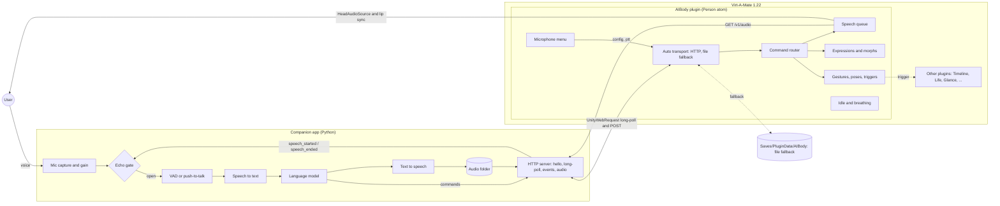

# AIBody: a virtual body for an AI in Virt-A-Mate

AIBody gives an AI a body in [Virt-A-Mate](https://www.virtamate.com/) (VaM). The body hears the
user through the microphone, speaks with lip sync, shows facial expressions, makes gestures and
poses, and keeps moving (idle motion and breathing) while it waits.

The project has two parts:

- **VaM plugin** (`src/`, C# 6): the *body*. A small `MVRScript` on a Person atom that plays speech
  audio, drives morphs, gestures and poses, holds the microphone settings menu and reports when it
  starts and stops speaking.
- **Companion app** (`companion/`, Python): the *brain*. It runs next to VaM and does everything
  the VaM plugin sandbox does not allow: microphone capture, voice activity detection, speech to
  text, the language model and text to speech. It also serves the speech audio over HTTP.

Status: **early (v0.2.0)**. The plugin compiles as C# 6 against API stubs but has not been run
inside VaM yet; every unverified VaM/Unity call is marked `TODO(verify)` in the code. The companion
runs end to end with mock engines (no real STT, LLM or TTS yet). See [Roadmap](#roadmap).

## Architecture



Flow of one turn:

1. The companion records the user (voice activation or push-to-talk), detects the end of the
   utterance (silence timeout) and transcribes it.
2. The language model answers with text plus an optional expression and gesture.
3. The companion synthesizes a WAV and sends `expression`, `gesture` and `speak` commands. The
   `speak` command carries a download URL (HTTP) and, if the VaM folder is known, a file path.
4. The plugin downloads the clip, queues it and plays it through the Person's `HeadAudioSource`.
   VaM's built-in lip sync moves the mouth.
5. The plugin reports `speech_started` and `speech_ended` from actual playback. The companion
   keeps the microphone closed in between (plus a short tail) so the AI does not hear and answer
   itself.

This is the same split that [Voxta](https://doc.voxta.ai/docs/integrations/vam) and
[VoiceControl2](https://github.com/StyleMavin/VoiceControl2) +
[VoskCompanion](https://github.com/StyleMavin/VoskCompanion) use: a thin client inside VaM and the
heavy work in a separate program.

## Repository layout

```
src/                     VaM plugin (C# 6). Entry: AIBody.cslist
  AIBodyPlugin.cs          MVRScript: settings, UI, frame loop, wiring
  ITransport.cs            transport interface (state, connection epoch)
  HttpTransport.cs         hello + long-poll + batched events, backoff (needs network access)
  FileTransport.cs         JSON files in Saves/PluginData (works without network access)
  AutoTransport.cs         HTTP primary, file fallback
  Protocol.cs              message types and helpers
  CommandRouter.cs         dispatches messages, sends ack / error events
  SpeechPlayer.cs          speech queue: URL download or file path, playback, speech events
  MicConfig.cs             microphone settings menu, device list, push-to-talk, level meter
  MorphHelper.cs           morph lookup and smooth blending layer
  ExpressionController.cs  expression presets (built-in + expressions.json)
  PoseController.cs        poses, gestures.json, Timeline and generic triggers
  IdleController.cs        idle head sway and head gestures (nod, shake, tilt)
  BreathingController.cs   procedural breathing on a chest morph
protocol/                PROTOCOL.md and JSON schemas
companion/               Python companion app (stdlib only for the core)
  aibody_companion/
    transport/             HTTP server (long-poll, audio), file transport, auto
    audio/                 capture + device control, mic settings, input processor, VAD, echo gate
    pipeline/              STT, LLM, TTS interfaces and mock engines
    orchestrator.py        ties it all together (tick loop)
  tests/                   unit and end-to-end tests (python -m unittest)
examples/                example commands and events, expressions.json, gestures.json
packaging/meta.json      VaM package metadata
tools/                   build_var.py (package), check_plugin.sh + stubs (compile check)
```

## Setup

### Requirements

- Virt-A-Mate **1.22** (VaM 1.x). VaM 2 does not support plugins yet.
- Windows PC that runs VaM, Python 3.10+ for the companion, a microphone.

### Install the plugin

Option A, as a package:

```
python tools/build_var.py          # creates dist/d0n.AIBody.1.var
```

Copy the `.var` into `<VaM>/AddonPackages/`.

Option B, as loose files (handy while developing): copy everything in `src/` to
`<VaM>/Custom/Scripts/d0n/AIBody/`. VaM recompiles when you reload the plugin.

Then in VaM:

1. Select a Person atom, open **Plugins**, **Add Plugin** and choose
   `Custom/Scripts/d0n/AIBody/AIBody.cslist` (from the package if you used option A).
2. Open the plugin's **Open Custom UI**. The left column has Connection, Speech output, Body and
   Advanced settings; the right column is the Microphone menu.
3. Keep the Person's **Auto Behaviors > Lip Sync** enabled. It animates the mouth from the audio.
4. Optional: copy `examples/expressions.json` and `examples/gestures.json` to
   `<VaM>/Saves/PluginData/AIBody/` and adjust them, then press
   **Reload expressions / gestures**.

### Enable the network connection

The network (HTTP) connection is the primary path. To allow it, enable
**User Preferences > Security > "Allow Plugins Network Access"** in VaM (it is off by default).

| Plugin "Transport" | Needs network access | Behaviour |
|--------------------|----------------------|-----------|
| Auto (HTTP, file fallback), default | for HTTP | Uses HTTP when the companion answers, otherwise the shared folder. Switches automatically. |
| HTTP only | yes | Only HTTP. |
| File only (no network) | no | JSON files in `Saves/PluginData/AIBody/<channel>/`, ~0.1 s latency. |

Connection settings: **Companion host** (default `127.0.0.1`), **Companion port** (default
`8765`) and **Channel** (default: the atom's name, e.g. `Person`; must match the companion's
`--channel`; use one channel and one companion per Person atom for several AIs). The status box
shows the connection state, retry countdown and last error. On any error the plugin retries with
backoff (0.5 s up to 10 s) and re-sends its settings after reconnecting, also when the companion
was restarted.

### Microphone menu

The microphone is captured by the companion, but configured in the plugin. Settings are saved
with the scene and applied by the companion live (0.3 s after the last change):

- **Mic enabled**, **Mic mode** (Voice activation / Push-to-talk), **Mic device** (list reported
  by the companion; **Refresh device list** asks again)
- **VAD threshold** (RMS level that counts as speech), **Input gain**, **Silence timeout**,
  **Min / Max utterance**, **Echo gate tail**
- **Push-to-talk active** toggle, plus the actions *Push-to-talk start / stop / toggle* for
  scene triggers or key bindings, and **Push-to-talk interrupts speech**
- **Show level meter**: a text meter (`[|||||....!.....] -32 dB`, `!` marks the threshold), the
  current mic state and whether the companion accepted the settings

### Speech output

**Speech volume** sets the playback volume. **Stop speaking** (button and trigger action) stops
the current clip and clears the queue. Clips play in order; the companion can also interrupt.

### Run the companion

```
cd companion
pip install sounddevice                                   # microphone support
python -m aibody_companion --list-devices                 # check the microphone
python -m aibody_companion --channel Person               # HTTP only, mic follows the plugin menu
python -m aibody_companion --vam-root "C:/VaM" --channel Person   # Auto: HTTP + file fallback
```

Options: `--transport auto|http|file`, `--host`, `--port`, `--no-mic` (text only),
`--no-stdin`, `--config config.json` (see `config.example.json`, including initial `mic`
settings). Typed lines on stdin make the body speak, which is handy for testing without a
microphone. With the mock engines the character answers "You said: ..." with a humming tone,
enough to test lip sync, expressions, gestures, queueing and echo gating. Put API keys for real
engines in environment variables, never in the repository.

Tests and checks:

```
cd companion && python -m unittest discover -s tests -t .
tools/check_plugin.sh              # needs the .NET SDK; compiles src/ as C# 6 against stubs
```

## Plugin sandbox limits

VaM compiles plugins itself (C# 6, Mono, .NET 3.5 profile) and runs them in a sandbox:

- **No `System.IO`.** File access goes through `MVR.FileManagementSecure.FileManagerSecure`.
  Writing is limited to `Saves/PluginData` (and `Custom/PluginData`). There is no reliable rename,
  so the plugin writes event files in place and the companion tolerates partial files.
- **No native DLLs, no `System.Diagnostics.Process`.** The plugin cannot start the companion or
  load speech engines. That is why the brain is a separate app.
- **Network only with permission, HTTP only.** Without "Allow Plugins Network Access", requests
  fail and Auto mode falls back to files. Raw sockets and WebSockets are not usable (no WebSocket
  client in Unity 2018.1 / .NET 3.5, sockets blocked), so the plugin long-polls with
  `UnityWebRequest`.
- **C# 6 only.** No tuples, `out var`, pattern matching or other C# 7+ features. `check_plugin.sh`
  enforces this.
- **Microphone inside VaM is unverified.** Whether Unity's `Microphone` class (and
  `Microphone.devices`) is usable from a plugin is not confirmed, so capture and device listing
  live in the companion.

## Protocol summary

Full spec: [protocol/PROTOCOL.md](protocol/PROTOCOL.md). Every message is a JSON object with
`v`, `type`, `id` and `ts`.

Companion to plugin: `ping`, `speak`, `stop_speaking`, `expression`, `set_morphs`,
`reset_morphs`, `gesture`, `pose`, `trigger`, `idle`, `breathing`, and for the microphone menu
`config_ack`, `devices`, `mic_state`, `mic_level`.

Plugin to companion: `ready`, `heartbeat`, `pong`, `ack`, `error`, `speech_started`,
`speech_ended`, `gesture_done`, `shutdown`, `config`, `ptt`, `list_devices`.

Example:

```json
{ "v": 1, "type": "speak", "id": "utt-0001",
  "url": "/v1/audio/utt-0001.wav",
  "audio": "Saves/PluginData/AIBody/Person/audio/utt-0001.wav",
  "text": "Hello, nice to meet you!", "expression": "happy", "queue": "append" }
```

## Reusing other plugins

AIBody keeps its own motion simple and is meant to work alongside established plugins on the same
atom. The `trigger` command and `gestures.json` (`kind: timeline` or `trigger`) can call actions and
set parameters on any of them.

| Plugin | Use for | Link |
|--------|---------|------|
| Timeline (Acid Bubbles) | keyframe animations for gestures and idle loops; "Play &lt;name&gt;" actions | [Hub](https://hub.virtamate.com/resources/timeline.94/), [wiki](https://hub.virtamate.com/resources/timeline-3-wiki.860/), [GitHub](https://github.com/acidbubbles/vam-timeline) |
| Life (MacGruber) | realistic breathing with chest movement and sounds, Gaze head motion | [Hub](https://hub.virtamate.com/resources/life.165/) |
| Glance (Acid Bubbles) | natural eye movement driven by head motion | [Hub](https://hub.virtamate.com/resources/glance-realistic-head-driven-eye-motion.5461/), [GitHub](https://github.com/acidbubbles/vam-glance) |
| E-Motion (VRAdultFun) | expressions and idle reactions from personality presets | VaMHub, search "E-Motion" |
| Naturalis (everlaster) | breast and glute physics | VaMHub, search "Naturalis" |
| Voxta (Acid Bubbles) | reference for the thin-client design, state triggers, echo handling | [docs](https://doc.voxta.ai/docs/integrations/vam) |
| VoiceControl2 + VoskCompanion | reference for a plugin talking to an external speech app | [plugin](https://github.com/StyleMavin/VoiceControl2), [companion](https://github.com/StyleMavin/VoskCompanion) |
| SpeechRecognition | in-VaM Windows speech recognition (legacy, breaks with Windows updates) | VaMHub |
| Embody, Dev Tools (Acid Bubbles) | code to study for VaM plugin patterns | [Embody](https://github.com/acidbubbles/vam-embody), [Dev Tools](https://github.com/acidbubbles/vam-devtools) |

Poses from VaMHub can be loaded with the `pose` command using the usual package path, for example
`Author.Package.1:/Custom/Atom/Person/Pose/name.vap`.

## Roadmap

1. **Test inside VaM 1.22** and fix every `TODO(verify)` in `src/`: HTTP with network access on
   and off, audio download and direct `AudioSource` playback (lip sync), `URLAudioClipManager`
   path loading, pose preset loading, Timeline action names, editable text fields, chooser
   updates for the device list, morph names.
2. **Real engines** in the companion: STT (faster-whisper or Vosk), LLM (local server such as
   Ollama, or a cloud API), TTS (Piper or XTTS). Run them on a worker thread and stream
   sentence by sentence into the speech queue.
3. **Better VAD** (webrtcvad or Silero) and **barge-in** in voice-activation mode with acoustic
   echo cancellation.
4. **States** (idle, listening, thinking, speaking) as plugin triggers, like Voxta, so scene
   builders can attach Timeline animations without code.
5. **Gaze and attention**: look at the user's camera while listening (or hand off to Glance).
6. Viseme-based lip sync from TTS timing data, as an alternative to VaM's audio lip sync.
7. Publish a `.var` on VaMHub.

## License

[LGPL-2.1](LICENSE).
