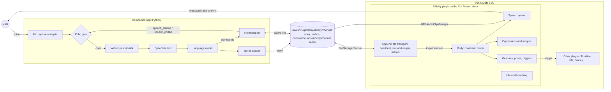

# AIBody – technical notes (English)

Former body of the README (architecture, setup details, sandbox limits, protocol summary, reuse of
other plugins). Purpose, the two-character setup and the complete settings reference are in the
English [README](../README.md).

## Load flow (the whole setup)

1. Copy `d0n.AIBody.32.var` to `<VaM>/AddonPackages/` (remove older AIBody packages, see below).
2. In VaM select the AI character's Person atom > **Plugins** tab > **Add Plugin** > choose
   `AddonPackages > d0n.AIBody.32:/Custom/Scripts/d0n/AIBody/AIBody.cslist`.
3. Start the companion app: `python -m aibody_companion --vam-root "D:\VaM"`.

That's it. The plugin's status box shows "Companion app: running ..." once both sides see each
other. Save the scene to keep the plugin and its settings with the character.

### Quick start: ask a question, hear the answer

The simplest flow, and the default: **simple Q&A** (`ai.mode` `qa`). You speak (or type in the
companion console), xAI speech to text transcribes it, Grok answers (streamed, sentence by
sentence), xAI text to speech speaks it, and the Person plays the WAV on her head audio with lip
sync. Speech only, no expressions or gestures, no proactive remarks. A few seconds of delay are normal.

1. Install the package and add the plugin to the Person (steps 1 and 2 above).
2. Start the companion app: `python -m aibody_companion --vam-root "D:\VaM"`.
3. Plugin tab *Voice* > section *Companion connection*: paste your xAI API key from console.x.ai into the
   field **XAI API Token** (plain text; version 21). It reaches the running app within a second.
   Alternatively start the app with the key in the environment (`set XAI_API_KEY=xai-...`, Windows
   `cmd`; PowerShell: `$env:XAI_API_KEY="xai-..."`); the field wins when both are set.
   AI mode `qa` (simple Q&A) is the default; the button **Question and Answer** was removed in
   version 39: with **Proactive talking** off the character only answers when asked, and Body
   control is not touched (scenes from 0.7.1 still have `auto`).
4. **Play test tone** (tone from the package) and **Test tone via companion** (tone through the
   app's audio folder): both must be heard.
5. Ask a question, or type `Hallo` + Enter in the companion console (same path without the mic).
   The status box shows `Last turn: Heard: ... / Answer ...` or a red error line.

Without an xAI key the same flow runs on the offline test engines ("You said: ..." with a tone)
and the status says so. If realtime is selected (`auto` / `realtime`) but not connected, or it does
not answer within 12 s after you spoke, the chain answers instead (with xAI) and the status says so;
**API Reconnect** tries realtime again.

## Architecture



Flow of one turn:

1. The companion app records the user (voice activation or push-to-talk), detects the end of the
   utterance (silence timeout) and transcribes it.
2. The language model answers with text plus an optional expression and gesture.
3. The companion app writes a WAV into `Custom/Sounds/AIBody/<channel>/` (see "Audio folder"
   below) and drops `expression`, `gesture` and `speak` commands into the channel's `inbox/`.
4. The plugin's AppLink picks them up and calls its Body directly.
5. The Body loads the clip with VaM's `URLAudioClipManager`, queues it and plays it through the
   character's head audio source. VaM's built-in lip sync moves the mouth.
6. The Body reports `speech_started` and `speech_ended` from actual playback. The companion app
   keeps the microphone closed in between (plus a short tail) so the AI does not hear and answer
   itself.

This is the same split that [Voxta](https://doc.voxta.ai/docs/integrations/vam) and
[VoiceControl2](https://github.com/StyleMavin/VoiceControl2) +
[VoskCompanion](https://github.com/StyleMavin/VoskCompanion) use: a thin client inside VaM and the
heavy work in a separate program.

Why one plugin: VaM never loads plugins from a `.var` on its own; every `.cslist` is one manual
"Add Plugin" step and compiles into one plugin slot. One `.cslist` with one MVRScript keeps the
setup to a single step and avoids any plugin-to-plugin bridge.

## Repository layout

```
src/AIBody/                the plugin (C# 6), one flat folder = what ships
  AIBody.cslist              the only entry: plain file names, no comments, no sub folders
  AIBody.cs                  AIBodyPlugin: the one MVRScript; owns AppLink + Body, status box
  AppLink.cs                 companion app link: transport, heartbeat, engine menus
  NetworkTransport.cs        hybrid link: loopback socket first, files as fallback
  SocketLink.cs              the only file with sockets (UDP on 127.0.0.1, background threads)
  FileTransport.cs           JSON files in Saves/PluginData via FileManagerSecure
  ITransport.cs              transport interface
  MicConfig.cs               microphone settings, push-to-talk, level meter (no device selection)
  Body.cs                    the character: settings, controllers, body state for heartbeats
  CommandRouter.cs           dispatches body commands, ack / error events
  SpeechPlayer.cs            speech queue: file path via URLAudioClipManager, playback, events
  MorphHelper.cs             morph lookup and smooth blending layer
  ExpressionController.cs    expression presets (built-in + expressions.json)
  PoseController.cs          poses, gestures.json, Timeline and generic triggers
  IdleController.cs          idle head sway and head gestures (nod, shake, tilt)
  BreathingController.cs     procedural breathing on a chest morph
  Diag.cs                    start-up diagnostics for the status box and the log
  Log.cs, Protocol.cs, UiHelper.cs
legacy/                    earlier plugin layouts (v0.4 Session/Person, v0.5 Client/Companion); not built
protocol/                  PROTOCOL.md and JSON schemas
companion/                 Python companion app (stdlib only for the core)
  aibody_companion/
    transport/               file transport (the only link to the plugin)
    audio/                   capture + device control, mic settings, input processor, VAD, echo gate
    pipeline/                STT, LLM, TTS interfaces, engines (offline test engines, xai.py,
                             elevenlabs.py), engine registry + fallback (engines.py)
    orchestrator.py          ties it all together (tick loop, heartbeat)
  tests/                     unit and end-to-end tests (python -m unittest)
examples/                  example commands and events, expressions.json, gestures.json
packaging/                 meta.json (shared) + AIBody.json (package overrides)
docs/BACKLOG.md            deferred features
tools/                     assemble_plugins.py (plugin folder), build_var.py (package),
                           check_plugin.sh/.py + stubs (sandbox, single-plugin and compile check)
```

## Setup

### Requirements

- Virt-A-Mate **1.22** (VaM 1.x). VaM 2 does not support plugins yet.
- Windows PC that runs VaM, Python 3.10+ for the companion app, a microphone.
- **"Allow Plugins Network Access"** (VaM *User Preferences > Security*, off by default) is needed for the optional
  loopback link (toggle **Network Active**, on by default). Without it the plugin still works through the file
  channel; see "Network Active" below. VaM's global switch and its per-plugin prompt are outside AIBody's control.

### Install the package

Download `d0n.AIBody.32.var` from the [releases](https://github.com/d0n/vam_plugin/releases), or
build it with `python tools/build_var.py` (writes `dist/d0n.AIBody.32.var`), and copy it to:

```
<VaM>/AddonPackages/d0n.AIBody.32.var
```

Remove all older AIBody packages from `AddonPackages`: `d0n.AIBody.1.var`, `d0n.AIBody.2.var`,
`d0n.AIBody.3.var` to `d0n.AIBody.28.var`, `d0n.AIBodySession.*.var`, `d0n.AIBodyPerson.*.var`,
`d0n.AIBodyPerson2.*.var`. Scenes saved with an older package point at that package's path, so
remove the old plugin entry from the character and add `d0n.AIBody.32` again, then save.

Contents:

```
d0n.AIBody.32.var
├── meta.json
└── Custom/Scripts/d0n/AIBody/
    ├── AIBody.cslist
    └── Log.cs, Diag.cs, Protocol.cs, UiHelper.cs, ITransport.cs, FileTransport.cs, MicConfig.cs,
        AppLink.cs, MorphHelper.cs, SpeechPlayer.cs, ExpressionController.cs,
        BreathingController.cs, IdleController.cs, PoseController.cs, CommandRouter.cs,
        Body.cs, AIBody.cs
```

Then follow the [load flow](#load-flow-the-whole-setup). If VaM asks whether to enable plugins
from this package, allow it. Keep the character's **Auto Behaviors > Lip Sync** enabled. Optional:
copy `examples/expressions.json` and `examples/gestures.json` to `<VaM>/Saves/PluginData/AIBody/`
and press **Reload expressions (expressions.json)** / **Reload poses** (tab *AI Character*).

Loose files instead of the package (handy while developing): copy `src/AIBody/` to
`<VaM>/Custom/Scripts/d0n/AIBody/` (or run
`python tools/assemble_plugins.py --out "<VaM>/Custom/Scripts/d0n/AIBody"`) and pick
`Custom/Scripts/d0n/AIBody/AIBody.cslist`. Use either the package or the loose files, not both.

### If the plugin window looks wrong (troubleshooting)

Since 0.6.2 the plugin window always starts with the status box, built before anything else. Since version 15 it is the ONE big info field (the tabs hold only controls). Since
version 16 it shows only the open tab; since version 17 it is 1800 high and the only element of the
left column (the header line above it is gone). First line: version and start result
(failures red), then the tab's info. Self test, recent events and start log are in the tab *Config*,
the connection lines (*Connection*) in *Voice*, the body lines (*Body*) in *AI Character*. It shows:

- **Info: <tab>**: help and status for the open tab (Voice: AI mode help, key and engine
  status; AI Character: pose count; Client Character: push-to-talk help, microphone status;
  Config: config.json path, channel, result of Reload Config JSON).

- **Self-test**: Person atom yes/no, head audio (`HeadAudioSource`) found, morphs (`geometry`)
  found, pose storage (`PosePresets` with `presetBrowsePath`), pose count (and preset files found
  with `GetFiles` on `Custom/Atom/Person/Pose`), breath morph found, expression morphs x of y found
  (missing names listed), Timeline storable present for `timeline` gestures (version 13),
  `Saves/PluginData/AIBody/<channel>` writable, companion app heartbeat seen. The body checks are
  recomputed at most every 5 s and sent as `selftest` in `ready`/`heartbeat`; the companion logs
  them as `Plugin self-test: …` once per change (warning when something is missing).
- **Connection** (tab Voice) / **Body** (tab AI Character): link state, companion app, audio,
  last turn, latency / speech, expression, breath morph (the channel folder is in the tab Config).
- **Startup log**: every Init step (`ok: ...`) and every failure as
  `FEHLER in <phase>: <exception type>: <message> | at <first stack line>`.

Every phase (AppLink, Body, storables, controllers, each UI block, link start) runs on its own: a
failing phase is marked and the rest of the window still appears. Head audio, morphs and the head
controller are looked up lazily and retried every 5 s, so a missing one only disables its feature.
On an atom that is not a Person (Session/Scene Plugins, an Empty, ...) the window explains where the
plugin belongs instead of staying empty. The same lines go to the VaM log with the prefix
`AIBody:`. For a bug report send a screenshot of the plugin window plus the red `AIBody:` lines from
the error log.

### Plugin settings (tabs)

All settings (menu, `config.json`, command line) are documented in the [README](../README.md#4-settings).

**Menu rule:** the menu shows only what can be configured. Pure path / info displays were removed in
0.7.4 (the folders are written once to the VaM log: `Settings file: ... | Expressions: ... | Gestures: ... | Audio ...`); texts that explain or
report a control (mode help, push-to-talk help, key / engine / mic status) stay. The status box shows
`Latency to first sound: X s (avg Y s, n turns)` with the breakdown (see *Latency* below).

**Sound check (no AI needed):** *Voice* > **Play test tone** plays `AIBodyTest.wav` from
the package on the head audio (no companion app involved); **Test tone via companion** lets the
app write a WAV into its audio folder and sends it like an answer. The status box shows
`Audio: Loading / Speaking: <file> / Done` or a red `Audio error: <reason>` (file missing, could not
be queued, no head audio, clip never started, speech volume 0), plus `Audio folder: <folder>` and
`Last turn: ...` (what was heard and answered, or which step failed) from the companion app.

**Audio folder:** the companion writes the speech WAVs to `Custom/Sounds/AIBody/<channel>/`,
below VaM's own folder for audio files (public plugins load audio from `Custom/` and packages; none
from `Saves/PluginData`, see [docs/API_AUDIT.md](API_AUDIT.md)). If VaM cannot load a WAV
there (the plugin reports the clip as failed), the app switches once to
`Saves/PluginData/AIBody/<channel>/audio/`, sends the same speech again from there and shows a red
note in the status box. A fixed `connection.paths.audio` in `config.json` turns the switch off.

**Hand-over of a speech file (no race):**

1. The companion writes the WAV to a temporary name in the same folder (`.<file>.<pid>.<n>.part`),
   flushes and fsyncs it, closes it and renames it with `os.replace` (atomic on Windows and POSIX)
   to its final name (`atomicfile.py`; used by `write_pcm_wav`, `write_audio`, `ToneTts` and the
   copy for the audio-folder switch).
2. Only then the `speak` command file goes into the inbox the same way. The plugin starts loading
   after it has read the command, so the existence of the command file is the signal that the WAV
   is complete. Before 19.11.2026 `ToneTts` (the offline / fallback engine) wrote its WAV in place
   and the folder-switch copy was a plain `copyfile`; both are atomic now.
3. Plugin: `SpeechPlayer.Enqueue` checks `FileManagerSecure.FileExists` (E10). If the file is not
   visible yet it stays queued ("Waiting for file: ...") and `Update` asks again every 0.25 s
   (event-driven, no sleeping); after the 15 s start timeout it fails with a clear message and the
   companion's `audio_failed` handling (folder switch) takes over. A size / RIFF-header check is
   not possible: no evidenced API reads binary files (`ReadAllBytes` / file size are not in
   `API_AUDIT.md`), and `ReadAllText` would corrupt the bytes. There is no `audio_loaded` event:
   `speech_started` already tells the companion (and the echo gate) when the sound really plays.

All settings are saved with the scene and mirrored to the shared config file
`<VaM>/Saves/PluginData/AIBody/config.json` (one object per tab; see [docs/CONFIG.md](CONFIG.md)).
The companion app reads it on start. A scene without saved AIBody settings takes its values from
that file once. The file also has an `ai` section (persona, language, fallback, realtime, proactive, xAI and
ElevenLabs settings) for the companion app; the plugin sets only its tab controls in it (AI mode,
voice, proactive, voice barge-in, key file paths) and keeps the rest.

If the companion app is missing or crashes, the plugin keeps running: the status shows
"DISCONNECTED", unread files in the channel folder are kept small (old commands are dropped, at most 20
old events are kept), and the link comes back by itself as soon as the app runs again. If the app
restarted while the body was speaking, the old speech is cancelled.

Actions for triggers: *Reconnect*, *Stop speaking*, *Reset expression*, *Reload config files*,
*Push-to-talk start / stop / toggle*. Gaze is not part of AIBody (the eyes belong to VaM); use
[Glance](https://hub.virtamate.com/resources/glance-realistic-head-driven-eye-motion.5461/) on the
same atom.

### Run the companion app

```
cd companion
python -m pip install sounddevice                         # microphone support
python -m aibody_companion --list-devices                 # diagnostics: list the input devices (the default one is used)
python -m aibody_companion --vam-root "D:\VaM"            # channel from config.json ("default")
```

First start (version 35): in an interactive console the app asks once "Do you want a green background to use pass-through?" and then "Do you want to use the standard scene as an example?" (yes / no); yes to the scene writes `Saves/scene/AIBody/AI-Buddy.json` (with or without the green background). `--setup` asks again, `--no-setup` skips it; answers in `config.json` > `setup`.

Options: `--channel` (default `default`), `--no-mic` (text only), `--no-stdin`, `-v` / `--verbose`
(DEBUG for every module, turn trace always on),
`--config config.json` (see `config.example.json`, including initial `mic` settings).
`--vam-root` is required: the app and the plugin exchange JSON and audio files in
`<VaM>/Saves/PluginData/AIBody/<channel>/` (speech WAVs: `<VaM>/Custom/Sounds/AIBody/<channel>/`).
A typed line on stdin is a question like a spoken one (language model -> text to speech -> VaM),
handy for testing without a microphone. With the offline test engines
(`null` / `echo` / `tone`, no xAI key) the character answers "You said: ..." with a humming tone, enough to
test lip sync, expressions, gestures, queueing and echo gating.

### Verbose log (debugging a turn)

Switch on **Verbose log** in the plugin tab *Config* (or `"advanced": {"verbose_log": true}` in
`config.json`, or start the app with `-v`). It is applied live, no restart.

- **Companion app:** console and log file show one line per step of every turn, with a turn id and the
  seconds since the turn started: what arrived (mic audio length / level, typed text, realtime events),
  the path taken (mode, chain or realtime, fallback), speech to text (engine, time, transcript),
  the language model request (engine, model, streaming), tags dropped or sent, every sentence, text to
  speech (engine, voice, time, WAV path, length), `speak sent`, and the plugin's answer (`plugin:
  speech_started` / `speech_ended` / `error`). Example:
  `[t0003 +0.84s] stt: engine='xai' ms=812 text='What time is it?'`
- **Log file:** `<VaM>/Saves/PluginData/AIBody/logs/companion.log` (next to `config.json`), always
  written (INFO; the trace only while Verbose log is on), rotating at 1 MB, 5 old files kept
  (`companion.log.1` ... `.5`). API keys never appear: keys read from the environment or a key file,
  `Bearer ...` and anything shaped like `xai-...` / `sk-...` are replaced by `***`.
- **Plugin:** `[debug]` lines in the VaM log (command received / failed, `PlayNow`, speaking, ended)
  and the last 8 of them under *Recent events* in the status box.

### AI modes (companion app)

| `ai.mode` | what runs |
|-----------|-----------|
Plugin: tab *Voice* > **AI mode**, or *Voice* > section *AI* > **Use realtime voice**
(on = `auto`, off = `qa`).

| `qa` (default) | simple Q&A: the chain below with `xai` instead of the offline test engines when an xAI key exists, speech only (no expressions / gestures), no proactive remarks |
| `auto` | `realtime` if an xAI key exists (and TTS is not `elevenlabs`), else `chain` |
| `realtime` | Grok Voice speech-to-speech over one WebSocket (`wss://api.x.ai/v1/realtime`, `grok-voice-latest`): the mic is streamed, the server detects the end of speech, the answer audio is cut into WAV segments and spoken from the first segment on; expressions / gestures via a function tool; interrupting stops the body; reconnects with backoff, chain runs meanwhile |
| `chain` | speech to text -> language model -> text to speech, exactly the engines selected in *Voice > AI Character* (below) |

In every mode but `chain`, an xAI key replaces the offline test engines (`null` / `echo` / `tone`)
with `xai` on the chain path (typed text, the realtime fallback); the engine menus keep their values.
If realtime is connected but gives no answer within 12 s after the user spoke, the app gives it up
until **API Reconnect** (or a mode change) and the chain answers.

- **Proactive talking** (toggle, `ai.proactive.enabled`): after the *Speech delay timer (s)* (default 90 s of silence; `ai.proactive.idle_seconds`, tab *Voice*) the AI may say
  something by itself, or stay silent (`[silent]`, nothing is played). Needs realtime or `llm: xai`;
  paused in `qa`. `idle_seconds` 0 switches it off (`ProactiveTimer.active`; below 1 s counts as 0),
  so there is never a nudge on every tick.
- **Time context:** the AI has no clock. Each user turn and nudge carries the local date/time and
  the time since the last exchange.
- **Echo:** without echo cancellation the mic sends silence while the body talks; to interrupt by
  voice in realtime mode use headphones and switch on **Voice barge-in (headphones)**. Push-to-talk
  always interrupts.
- Details: [docs/CONFIG.md](CONFIG.md#modes-realtime-voice-and-chain).

### API key

xAI needs an **API key from [console.x.ai](https://console.x.ai)** (starts with `xai-`, API credit).
A Grok subscription (SuperGrok / X Premium) or a grok.com login token is not an API key and is
refused by `api.x.ai`. Without a key the companion warns at start and runs the offline test engines;
the key status in the info field (tab *Voice*) says which key is needed (red when the server refused it).

### Body tools (the AI moves the body)

In `auto` / `realtime` / `chain` with **Body control** on, the language model gets function tools:
`express` (expression and / or gesture from the loaded lists) (no `pose` tool since version 32: poses only through pose commands).
Realtime: `function_call` -> commands to the plugin -> `function_call_output`; chain: `/v1/responses`
with `tools`, the outputs go back with `previous_response_id` (at most 3 tool-only rounds per turn).
Every call gets a result (`{"ok": true}` or `{"ok": false, "error": ...}`) so the model never waits.
Not offered in `qa` (speech only) or with Body control off; a stray call is answered `ok: false`.
Body control off (version 35, SPEC "Body control"): the plugin ignores `expression`, `set_morphs`, `reset_morphs`, `gesture`, `pose`, `trigger`, `idle` and `breathing` and runs no idle poses; speech and the user's own menu buttons still work.
Idle poses and own idle motion (version 35): `IdlePoses.cs` (`IdlePoseScheduler`, pure C#, tested with `companion/tests/csharp_idle_harness`) picks the next pose; `IdleController` adds head sway, chest weight shift and breath rise as additive rotation offsets on `headControl` / `chestControl` (re-based after each pose load); no third-party plugin or code.
### Gaze and blinking (versions 25 to 36, removed)

Leon, 20.11.2026: the eyes belong entirely to VaM. `GazeController.cs` and `BlinkController.cs`, the AI tool `look_at`,
the status fields `gaze_control` / `gaze_atoms` and the scene actions for gaze and blinking are gone. A `look_at` from an
older companion app is accepted and ignored. VaM's own eye movement and blinking are not touched.

### Latency

Measured per turn from the end of your speech (VAD end, push-to-talk release, Enter in the console;
realtime: the server's `speech_stopped`) to the first sound (the plugin's `speech_started`).
Breakdown (chain): STT, LLM first token, first sentence, TTS, file write, to plugin, plugin start;
(realtime): server first audio, segment, to plugin, plugin start. One INFO line per turn in the
console / `companion.log` (`Latenz t0003 bis zum ersten Ton: 2.41 s – STT 0.80 · ...`), a trace step
in the verbose log, and the last value plus the average of the last 10 turns in the plugin status box.

### AI engines (chain mode)

One answer = speech to text -> language model -> text to speech, chosen in the plugin's
**AI** tab (or `engines` in `config.json`):

| kind | engines | key |
|------|---------|-----|
| Speech-to-text | `null` (offline, hears nothing), `xai` (`POST https://api.x.ai/v1/stt`, grok-voice-transcribe-2.0) | `XAI_API_KEY` |
| Language model | `echo` (offline test), `xai` (Grok, `POST https://api.x.ai/v1/responses`, streamed) | `XAI_API_KEY` |
| Text-to-speech | `tone` (offline test tone), `xai` (`POST https://api.x.ai/v1/tts`), `elevenlabs` (`POST https://api.elevenlabs.io/v1/text-to-speech/{voice_id}`) | `XAI_API_KEY` / `ELEVENLABS_API_KEY` |

- The answer is streamed: the first sentence is synthesized and queued on the body while the
  model is still writing. The persona goes into `instructions`; the conversation continues with
  `previous_response_id`. The model may start with a tag like `<<happy nod>>`, which becomes the
  existing `expression` / `gesture` commands.
- Every TTS engine writes 16-bit PCM WAV into the channel's `audio/` folder (VaM's audio loader
  plays WAV; WAV also gives the exact duration for the echo gate).
- **Keys:** xAI precedence (since version 24): 1. the plugin field **XAI API Token** (tab Voice > Companion connection;
  plain text, no format check; sent to the app in the `config` event as `keys.xai`, an empty field = no
  token and the next source applies), 2. `ai.xai.api_key` in `config.json` (PLAIN TEXT; the plugin writes
  the field there with FileManagerSecure, keeping all other keys, and reads it on start to fill the field;
  the app reads it too), 3. the environment variable `XAI_API_KEY`, 4. the PATH of a key file
  (`ai.xai.key_file`). Masked display: the first 4 and last 4 characters stay visible with stars between them
  (`xai-****abcd`), as soon as the field loses focus and after every start; while the field has focus it shows the
  real text (`InputField.isFocused`, polled each frame). The real token is held separately (`_xaiToken`), text
  with `****` typed into the field is ignored, so the mask never overwrites the token. `InputField.contentType = Password` was NOT used: no
  evidence for it in `docs/API_AUDIT.md`. Nothing is written before `config.json` was read successfully
  (an early empty field cannot wipe a saved token). `ai.xai.api_key_warning` next to the token carries the
  security notice (the same text is at the top of the left info field of the tab Voice). ElevenLabs has no
  menu field: `ELEVENLABS_API_KEY` or `ai.elevenlabs.key_file`. Never a real key in the repository; every registered key is masked in the app's log and console (config events with
  `keys` are logged masked, the plugin logs only "keys masked"). The token passes through one event
  file in `Saves/PluginData/AIBody/<channel>/outbox/` which the app deletes right after reading
  (plain text on disk for that moment; the scene file holds it permanently). Without a key the engine stays selectable but shows **"not configured"** in the
  info field and the fallback (`ai.fallback`, default `null` / `echo` / `tone`) runs. A key file
  added later is picked up within 10 s; a new environment variable needs an app restart.
- If a request fails, that sentence / answer uses the fallback engine; nothing stops.
- All settings (model, voice, language, persona): [docs/CONFIG.md](CONFIG.md).

Internet access exists only in the companion app. The VaM plugin has exactly one network component: the optional loopback
link to the companion app (`SocketLink.cs`, see "Network Active"); it never talks to the internet.

Tests and checks:

```
cd companion && python -m unittest discover -s tests -t .   # incl. end-to-end simulation (fake plugin)
python tools/check_plugin.py   # needs the .NET SDK: strict sandbox scan, single-plugin check, compile (C# 6)
python tools/build_var.py      # builds dist/d0n.AIBody.<N>.var and scans every file inside it
```

## Example scene: green screen / passthrough

`examples/scenes/AI-Buddy.json` is a VaM scene template (in the package as `Saves/scene/AIBody/AI-Buddy.json` with the preview `AI-Buddy.jpg`, the "Scene" choice): two people, female `Person` (`Female 1`) with AIBody, male `BryanGosling` (`Male 4`) without a plugin, clothing and looks from the original scene. Third-party packages used by the scene are declared in `packaging/meta.json` `dependencies`; loose `Custom/` and `Saves/` files are not redistributed and need local content (see `docs/SCENE_GREENSCREEN.md`). Since version 37 the Load Scene menu can show the thumbnail next to the scene. Since version 36 the optional greenscreen is AIBody's own `Background.cs` (tab Config > Background: toggle default OFF in the plugin, color picker default #00FF00; the packaged AI-Buddy scene saves it ON): camera clear color + skybox off through `CameraTarget.centerTarget.targetCamera` and `SkyshopLightController.singleton` (E30-E32), old values restored on off / disable. Until version 35 Sally's Camera Background Color did this. The headset (e.g. Virtual Desktop chroma key on the same color) makes it transparent, not VaM.

Latency (version 36, code only, no feature): the companion keeps HTTPS connections alive in one pool (`pipeline/http.py`) and pre-connects when the user starts speaking; threads wake the main loop at once (`wakeup.py`); the first spoken piece may end at a clause mark; speech and command files skip fsync (`atomicfile.durable=False`, still atomic). The plugin starts speech the frame VaM has loaded the clip (`SpeechPlayer.ClipReady`), builds status texts only while its UI is open and avoids per-frame copies (socket queue swap, empty inbox scan). Steps: [docs/SCENE_GREENSCREEN.md](SCENE_GREENSCREEN.md).

## Plugin sandbox limits

VaM compiles plugins itself (C# 6, Mono, .NET 3.5 profile) and runs them in a sandbox. A plugin
that uses a blocked API does not load at all. AIBody uses only APIs that public, working VaM
plugins use (evidence per API in [docs/API_AUDIT.md](API_AUDIT.md)); anything without such
evidence was removed, not worked around. `tools/check_plugin.py` and `tools/build_var.py` enforce
it with a strict scan of every file in `src/` and in the built `.var` (code, comments and strings):
zero matches for `UnityWebRequest`, `UnityEngine.Networking`, `WWW`, `System.IO`, `System.Net` (allowed only in
`SocketLink.cs`), sockets (same file), `Process`, `System.Diagnostics`, reflection, `Assembly.Load`, `DllImport`, the Unity
microphone API and `OpenURL`. The compile stubs in `tools/stubs` declare only the evidenced VaM
members, so using anything else fails the compile.

- **The stub compile is not VaM's compiler.** It uses Roslyn; VaM uses an old Mono `mcs`. Version 13
  passed the stub compile but failed in VaM with `CS584: Internal compiler error: Unexpected error
  when loading type 'System.Collections.Generic.Dictionary<TKey,TValue>.ValueCollection.Enumerator'`
  for a `foreach` over a dictionary's values (`ExpressionController.cs`, getter at line 40).
  Rule since version 14: never `foreach` or LINQ over `dict.Keys` / `dict.Values`; iterate the
  dictionary itself with `KeyValuePair` (as `MorphHelper` has done since the first version) or copy
  with `new List<T>(dict.Keys)`. The strict scan (`tools/sandbox_rules.py`) rejects these constructs
  and the `KeyCollection` / `ValueCollection` types; `companion/tests/test_vam_compiler_rules.py`
  pins the rule.

- **No `System.IO`.** File access goes through `MVR.FileManagementSecure.FileManagerSecure`.
  Writing is limited to `Saves/PluginData`. There is no reliable rename, so the plugin writes
  event files in place and the companion app tolerates partial files.
- **No native DLLs, no `System.Diagnostics.Process`, no reflection.** The plugin cannot start the
  companion app or load speech engines. That is why the brain is a separate app.
- **Network only through `SocketLink.cs`** (no `UnityEngine.Networking`, no `UnityWebRequest`, no `WWW`; the
  one loopback UDP socket is the only exception, and it can be switched off). The always-available
  companion app link is the shared folder; speech audio is loaded from a local file path with
  VaM's own `URLAudioClipManager` and played with the head `AudioSourceControl` (the Dollmaster /
  FreeMMD pattern).
- **C# 6 only.** No tuples, `out var`, pattern matching or other C# 7+ features.
- **One MVRScript per `.cslist`**, flat file list (sub folder paths inside a `.var` are
  unverified).
- **No microphone API in the plugin.** Capture lives in the companion app, always from the system
  default input (no device selection, no device list); the plugin only sends settings and
  push-to-talk as files and shows the state the app reports.

### API audit (v0.6.1)

Kept, each with a public plugin that uses it (links in [docs/API_AUDIT.md](API_AUDIT.md)):
`FileManagerSecure` (CreateDirectory, FileExists, ReadAllText, WriteAllText, DeleteFile,
GetFiles(dir)); `URLAudioClipManager` (QueueClip after `NormalizeMediaPath`, GetClip, RemoveClip);
the `HeadAudioSource` `AudioSourceControl` (PlayNow, Stop, volume, audioSource); morphs via
`geometry` > `DAZCharacterSelector.morphsControlUI` > GetMorphByDisplayName / GetMorphByUid;
`headControl` rotation; Timeline via `GetStorableIDs` + `CallAction("Play <name>")`; pose presets via
`presetBrowsePath` + `NormalizePath` + `CallAction("LoadPreset")`; generic triggers via CallAction
and Get*JSONParam; the standard MVRScript UI.

Removed: the optional HTTP transport and `--http` build, the `speak.url` field, the transport
chooser, the companion app's HTTP/auto modes, the clip readiness check (`clipToPlay`), action-name
lookup before `CallAction`, the `GetFiles` search pattern, the direct `AudioSource.Play` fallback.

## Protocol summary

Full spec: [protocol/PROTOCOL.md](../protocol/PROTOCOL.md) (version 3). Every message is a JSON
object with `v`, `type`, `id` and `ts`.

Companion app to VaM: body commands `speak`, `stop_speaking`, `expression`, `set_morphs`,
`reset_morphs`, `gesture`, `pose`, `trigger`, `idle`, `breathing`; `ping`,
`companion_heartbeat`, and for the microphone settings `config_ack`, `mic_state`,
`mic_level`.

VaM to companion app: `ready`, `heartbeat`, `pong` (with the body's state), `config`, `ptt`,
`shutdown`, `speech_started`, `speech_ended`, `gesture_done`, `ack`, `error`.

Example:

```json
{ "v": 3, "type": "speak", "id": "utt-0001",
  "audio": "Custom/Sounds/AIBody/default/utt-0001.wav",
  "text": "Hello, nice to meet you!", "expression": "happy", "queue": "append" }
```

### Earlier versions

v0.2 shipped one plugin (`d0n.AIBody.1.var`), v0.3/v0.4 a Session plugin plus Person/Person2
plugins with character slots (protocol v1), v0.5 a Client and a Companion plugin in
`d0n.AIBody.2.var` (protocol v2), v0.6.0 the same single plugin as now in `d0n.AIBody.3.var`
(still with an optional HTTP build, removed in 0.6.1). The older sources are kept in [legacy/](../legacy/) for reference; use
the tags `v0.4.0-session` or `v0.5.0` for a buildable tree.

## Reusing other plugins

AIBody keeps its own motion simple and is meant to work alongside established plugins on the same
atom. The `trigger` command and `gestures.json` (`kind: timeline` or `trigger`) can call actions and
set parameters on any of them.

| Plugin | Use for | Link |
|--------|---------|------|
| Timeline (Acid Bubbles) | keyframe animations for gestures and idle loops; "Play &lt;name&gt;" actions | [Hub](https://hub.virtamate.com/resources/timeline.94/), [wiki](https://hub.virtamate.com/resources/timeline-3-wiki.860/), [GitHub](https://github.com/acidbubbles/vam-timeline) |
| Life (MacGruber) | realistic breathing with chest movement and sounds, Gaze head motion | [Hub](https://hub.virtamate.com/resources/life.165/) |
| Glance (Acid Bubbles) | natural eye movement driven by head motion | [Hub](https://hub.virtamate.com/resources/glance-realistic-head-driven-eye-motion.5461/), [GitHub](https://github.com/acidbubbles/vam-glance) |
| E-Motion (VRAdultFun) | expressions and idle reactions from personality presets | VaMHub, search "E-Motion" |
| Naturalis (everlaster) | breast and glute physics | VaMHub, search "Naturalis" |
| Voxta (Acid Bubbles) | reference for the thin-client design, state triggers, echo handling | [docs](https://doc.voxta.ai/docs/integrations/vam) |
| VoiceControl2 + VoskCompanion | reference for a plugin talking to an external speech app | [plugin](https://github.com/StyleMavin/VoiceControl2), [companion](https://github.com/StyleMavin/VoskCompanion) |
| SpeechRecognition | in-VaM Windows speech recognition (legacy, breaks with Windows updates) | VaMHub |
| Embody, Dev Tools (Acid Bubbles) | code to study for VaM plugin patterns | [Embody](https://github.com/acidbubbles/vam-embody), [Dev Tools](https://github.com/acidbubbles/vam-devtools) |

Poses from VaMHub are applied through pose commands (version 32): put the pose file in `Custom/Atom/Person/Pose` (or
`.../Pose/AIBody`, or a package) and name the pose like a command, or link a command to it with **Add Pose** in the
plugin; the `pose` protocol command carries only the JSON `{"pose":"<id>"}` of a vocabulary entry.

## Roadmap

1. **Test inside VaM 1.22** and fix every `TODO(verify)` in `src/AIBody/`: that the plugin loads
   from the `.var` in the sandbox, `FileManagerSecure.GetFiles` paths, `URLAudioClipManager`
   loading of a `Saves/PluginData` path and `PlayNow` playback (lip sync, start detection), the
   `PosePresets` storable, editable text fields, chooser updates, morph names (breath morph).
2. **Real engines** in the companion app (STT, LLM, TTS), streamed sentence by sentence.
3. Everything else is parked in [docs/BACKLOG.md](BACKLOG.md) (deferred ideas).

Agreed spec: [docs/SPEC.md](SPEC.md); status done / open: [docs/REQUIREMENTS.md](REQUIREMENTS.md).

### Voice detection and echo lock (since version 24)

`audio/vad.py`, used by `audio/input_processor.py` for utterances (voice mode) and the level meter.

- **Built-in detector** (`EnergyVad`, always available): frame RMS against a *noise floor*. The floor falls
  quickly when the room gets quieter and rises slowly when it gets louder, and it never learns from speech.
  *Hysteresis*: starting needs `strictness ratio` x floor (2 / 2.5 / 3 / 4, default 3), continuing only about half
  of that, so a quiet syllable does not cut a word. *Hangover*: 3 frames (90 ms) bridge short gaps. The utterance
  segmenter adds `min_utterance_ms` and `end_silence_ms`. *Steady-noise rule*: a level that hardly changes for about
  6 s above the threshold (fan, hum) becomes the new floor instead of keeping the detector open; speech wobbles
  from frame to frame and is not affected. `vad_threshold` is the lowest RMS that can ever count as speech.
- **webrtcvad** (optional): `python -m pip install webrtcvad-wheels` (pre-built Windows wheels, imports as
  `webrtcvad`, no torch). `mic.vad_strictness` is its mode 0-3. A frame counts only if webrtcvad says speech AND
  RMS >= `vad_threshold`; same hangover. Needs 16-bit mono at 8/16/32/48 kHz and 10/20/30 ms frames (the defaults
  16 kHz / 30 ms fit); otherwise the built-in detector runs.
- **Selection** (`mic.vad_engine`): `auto` = webrtc if it imports, else built-in, quietly; `webrtc` = same, but the
  status line says why it is not used; `energy` = built-in only. The detector that really runs is reported in
  `mic_state.vad` / `vad_note` and shown in the info field.
- **Echo lock** (checked 19.11.2026): `EchoGate` closes when a `speak` is sent and opens `echo_tail_s` after
  `speech_ended` (failsafe deadlines, `audio_failed` / `ready` / `shutdown` open it). While it is closed
  `InputProcessor` drops the frame, aborts a running utterance and puts the detector on `hold()`, so the body's own
  voice can neither start an utterance nor teach the detector a higher noise floor (flaw fixed: it used to
  learn from the echo). Realtime mode: `feed_mic` sends silence frames while `RealtimeVoice.echo_locked()`, which is
  the gate OR an answer still being delivered (flaw fixed: between two clips of one answer the gate could open
  and the server heard the body; failsafe 90 s). Not solved: there is no acoustic echo cancellation, so
  interrupting by voice still needs headphones (`send_while_speaking`); push-to-talk always works.
- Not testable without hardware: how a real microphone, room and speakers behave (thresholds, the tail length, whether
  speaker sound leaks after the tail). See `docs/TEST_PROTOCOL.md` T13.

### Microphone diagnostics without VaM

`python tools/mic_test.py` prints every PortAudio device raw, the input devices per host API and the
input devices of the default host API (`list_input_devices`, the same list as `--list-devices`), and
writes `mic_test_output.txt`. Diagnostics only: the companion app always records from the system
default input (`sounddevice` default, `MicCapture` opens `device=None`), there is no device menu and
no `devices`/`list_devices` message since 19.11.2026. An old `mic.device` in config.json, a `config`
event or a saved scene, and an old plugin's `list_devices` event are ignored quietly
(`audio/mic_settings.py` `RETIRED`, `protocol.RETIRED_EVENTS`).

### Local engines, Silero, voice barge-in (since version 29)

- **Ollama** (`pipeline/ollama.py`, `OllamaLlm`): `POST {base}/api/chat` with NDJSON streaming, no key. Ollama keeps no conversation: the class keeps `messages` (last `max_messages`; only a real answer enters), the system message is persona + `xai.STYLE_RULES` (the `<<expression gesture>>` tag; no tool calls: `supports_tools = False`). `complete()` is a plain request (memory summaries); `EngineSet.memory_llm()` returns an `OllamaLlm` when ollama is the effective llm. Errors: connection refused / unknown model are turned into plain messages (`ollama serve`, `ollama pull <model>`); the normal fallback (echo) answers meanwhile. The engine needs no key, so `configured()` is true; its status line says it is checked on use.
- **Silero** (`audio/silero.py`): `SileroVad` over an onnxruntime session (model v5: inputs `input` [1, 64 context + 512], `state` [2,1,128], `sr`). 30 ms frames are collected into 512-sample chunks, the last probability counts; threshold from `vad_strictness` (0.3/0.4/0.5/0.65), `vad_threshold` stays an RMS floor, 3 frames of hangover. `hold()` (gate closed) resets state and buffer. `load_silero` runs one chunk at load, refuses other sample rates and model versions with a plain note. `make_vad(..., silero_model=...)`: `silero` = silero or the energy detector with a note; `auto` = silero only when the model file exists, then webrtcvad, then energy. Path: `AIBODY_SILERO_MODEL` or `<VaM>/Saves/PluginData/AIBody/models/silero_vad.onnx` (`silero_model_path`); the model is not in the package. Plugin: one more entry in the **VAD engine** popup (`mic.vad_engine: "silero"`).
- **Voice barge-in** (`audio/barge.py`, `BargeInRule`, `ai.barge_in`): while the gate is closed and `gate.is_speaking` (speech_started seen; ), the echo level is a decaying peak (teaching only with frames that are not loud, first 450 ms only teach); `min_ms` of frames above `ratio` times echo and `floor` fire the rule and return the frames (kept with their gain). Chain: `InputProcessor.process` stores them (`barge_frames`), `Companion.handle_audio_frame` calls `voice_barge_in`: cancel turns, `stop_speaking`, gate `force_open`, realtime `barge_in(manual=True)`, then the frames go through `process(gained=True)` (chain) or `RealtimeVoice.send_frames` (realtime; `feed_mic` hook). Only in mode `vad`. Off by default.

### One character per app (since version 30)

- The companion app controls exactly one character in the folder `Saves/PluginData/AIBody/default/`. Version 28's
  "several figures in one app" (channel list, `Channel` field, per-channel state, routing by name) was removed on
  purpose (Leon, 19.11.2026): one app, one plugin, one persona, one memory. For a second character, run a second VaM
  instance and app. `--channel` is accepted but ignored (with a warning); `ai.channels`, `connection.channel` and the
  plugin's `Channel` value in old files and scenes are tolerated and ignored.

### Network Active (since version 30)

- **Toggle:** *Config > Network Active* (`JSONStorableBool`, on by default, saved with the scene and mirrored as
  `connection.network_active` in config.json). Off = no network code runs at all (`SocketLink` is never constructed);
  the file channel works as before.
- **Transport:** UDP on `127.0.0.1` only. One datagram = one complete JSON message (at most 60000 bytes; larger ones
  and every config event with a token go through the file channel). The companion listens on `127.0.0.1:38437`
  (`connection.network_port`, file only; 0 = no listener) next to the file inbox; the plugin binds an ephemeral
  loopback port and sends `hello` (key `net`), the app answers `hello_ack`, then both sides exchange the normal command and
  event JSON. The token never travels over the socket (the app reads it from config.json).
- **Never blocks VaM:** two background threads (receive, send) and locked queues; `Update` only moves finished
  messages. No connect, so nothing can hang; hello is repeated with a growing delay while there is no answer.
- **Fallback:** the link counts as up while the other side was heard within 6 s (plugin) / 5 s (app). If not
  (companion not running, VaM's network switch off, bind failed), all traffic uses the files, automatically, and
  switches back when the socket works again. The info field shows `Network: off`, `Network: connected`, `Network: connecting ...` or
  `Network: unavailable, using files`.
- **VaM's permission:** VaM's global "Allow Plugins Network Access" and its per-plugin prompt are outside AIBody's
  control; the plugin shows no prompt of its own. TODO(verify) in VaM: what exactly happens with the preference
  off (exception caught by `SocketLink`, VaM refusing to load the plugin, or a prompt).
- **Code:** `SocketLink.cs` (sockets, threads), `NetworkTransport.cs` (hybrid transport over file + socket),
  `companion/aibody_companion/transport/{socket_transport,hybrid}.py` (companion side), tests
  `companion/tests/test_network.py` (real sockets) and a .NET harness that compiles `SocketLink.cs`.

### Pose commands (since version 32)

- **Where:** companion `aibody_companion/pose_commands.py` (vocabulary, normalization, strict JSON, `PoseVocabulary`), the gate in `Companion._turn` (before history and the language model, for typed text and speech-to-text results), `Companion.pose_command` (remote action), `RealtimeVoice._pose_command` (transcript of the realtime server); plugin `src/AIBody/PoseVocabulary.cs` (pure C#: no VaM types, no LINQ, no Dictionary key enumeration), `PoseController.ApplyPoseJson`, `CommandRouter.CmdPose`, `Body.cs` (Poses section of the tab AI Character, `LoadPoseCommands`, `WriteSettings` writes `poses.commands`, `AddStatus` writes `pose_commands`).
- **Normalization (both sides, identical):** trim the white-space set (ASCII white space, NEL, NBSP, U+1680, U+2000-200A, U+2028/2029, U+202F, U+205F, U+3000), remove trailing `.` `!` `?` `…` `。` `！` `？` and white space (repeated), lower-case, collapse inner white space to one space. A match is `==` on the result; an empty result never matches.
- **Flow:** `Companion._turn` has the text -> `pose_decision(text)` -> `None` (not a command: normal conversation) or a `PoseDecision` with steps: unavailable = a warning log and a status line only; available = `("command", pose)` with `json={"pose":"<id>"}` and `command="<label>"`, and the status line "Pose command: ...". No model call, no speech, no history entry. Gate off when *Body control* is off (the words go to the conversation like any text). The model has no `pose` tool (`body_tools` refuses a stray call with an error result), the realtime prompt does not mention one.
- **Availability:** the companion learns the live vocabulary from the plugin's status field `pose_commands` (`[{command, pose, available}]`) and falls back to `config.json`; a command is available when the character has a pose that matches the linked pose id by `PoseKey` (lower-case letters and digits only, so `Preset_Sit Down`, `sit_down`, `Sit-Down` are the same pose).
- **Plugin side:** `CommandRouter.CmdPose` reads only the `json` field; `ApplyPoseJson` parses it strictly (`ParsePoseJson`: exactly one key `pose`, non-empty text, no duplicate keys, nothing after the object, at most 400 characters), finds the vocabulary entry by pose id (`FindByPoseId`), resolves it against `PoseController.PoseNames` and only then calls `ApplyPose`. Any failure: `Log.Warn("Pose ignored: ...")` (one English line `AIBody: Warning: Pose ignored: ...`), nothing applied. A `kind: pose` entry of `gestures.json` is refused as a gesture. Manual **Apply pose** in the menu stays (a user action).
- **Realtime:** the server answers by itself, so the gate also runs on `conversation.item.input_audio_transcription.completed`. On a match: pose command, `response.cancel` plus stop speaking if an answer is running, and a drop window (8 s, only when no response was created since `speech_stopped`) for an answer that starts right after. TODO(verify) with the real xAI realtime server (T26).
- **Tests:** `companion/tests/test_pose_commands.py` (gate vectors, chain and realtime flows with the fake plugin and fake server, protocol, config round trip, source rules) and a .NET harness (`tests/csharp_pose_harness`) that compiles the plugin's real `PoseVocabulary.cs` and compares it with the Python code on shared vectors (normalization, keys, gate, JSON parsing, Add / Remove / Restore logic).

### Remote control (since version 31)

- **Where:** `companion/aibody_companion/remote/`: `core.py` (action table, `parse_action` validation, `RemoteControl`: bounded queue of 50, status snapshot, `process(app)` called from `Companion.tick()`), `http_server.py` (`ThreadingHTTPServer` on `127.0.0.1`), `osc.py` (UDP listener, OSC 1.0 parser with bundles), `panel.py` (the web page, one self-contained document). Wiring in `cli.start_remote`; settings in `settings_file.py` (`remote` category, `ensure_remote_token`).
- **Threads:** the two servers run on their own daemon threads. They only validate and put `(action, params, source)` into the queue; `process()` runs on the main loop thread, so the same single-threaded rules as for plugin events hold. Names of expressions / gestures / poses are checked against the lists of the last status snapshot and mapped to the plugin's spelling.
- **Actions run as:** `say` -> `Companion.say_text` (a "say" turn on the worker thread: sentences -> text to speech -> `speak`, no language model; the emotion fallback still applies), `ask` -> `handle_user_text`, `event` -> `handle_scene_event`, `stop` -> `cancel_turns` + `stop_speaking`, `ptt` -> `handle_ptt` (mode `ptt` only), `expression` -> command `expression` (needs Body control), `gesture` / `pose` / `look` -> `tool_commands` (the AI's own resolution and switches).
- **Security:** see `REMOTE.md` "Protection". Bind address fixed to `127.0.0.1`; token compare `hmac.compare_digest`; `Host` / `Origin` allow-list; no CORS; token only in headers (never in the address, so it cannot land in a log); the token is registered with `logsetup.add_secret`.
- **config.json:** the `remote` section is owned by the app and the user; the plugin copies the existing `remote` object into the file it writes (`AIBody.WriteSettings`), like `ai`. `ensure_remote_token` writes a generated token atomically and keeps everything else.
- **Tests:** `companion/tests/test_remote.py` (real HTTP and UDP sockets on ephemeral ports, main-loop integration with the fake plugin).

### Plugin preset (since version 31)

`tools/build_var.py` writes `Custom/Atom/Person/Plugins/AIBody/Preset_AIBody.vap` into the `.var` (and into `contentList`): the PluginManager's `plugins` map with one entry, the package's `.cslist` with the package version of this build. See `API_AUDIT.md` "Version 31" for the evidence and the open VaM check (T23). Test: `companion/tests/test_plugin_preset.py`.

### First-run note and token mask (since version 30)

- At the top of the plugin UI one note with one text field and one button (`BuildFirstRunHint`): "An xAI API token
  is required. Paste it here, or later in Voice > XAI API Token." The button reads **Close** while the field is
  empty and **OK** once something is typed (OK saves the token exactly like the token field in the tab Voice, then
  closes). It is never shown again once a token exists or after closing; `ui.first_run_hint_dismissed` in config.json
  remembers that. The field follows the same masking rules as the token field.

### Emotions, personas, memory (since version 27)

- **Emotion fallback** (`emotion.py`, `Companion._emotion_for_speech`): every spoken sentence (chain and realtime both pass `_queue_speech`) that came without an AI-chosen expression in the same answer gets an expression from keyword rules (German and English; happy, sad, angry, surprised, thinking), sent as the normal `expression` command right before the `speak`. Only names the plugin lists are used. "The AI chose one" = a tool call `express`, a `<<tag>>` or `send_directive` in this answer (`EmotionDirector.begin_answer()` starts a new answer in `_turn` and on `response.created`).
- **Fade and listening** (`Companion._maybe_emotion`, every tick): while the user talks (push-to-talk, VAD in speech, realtime `user_speaking`) the plugin preset `listening` (Brow Inner Up 0.18, Mouth Smile Simple 0.08, not offered to the AI: `emotion.offered()` filters it from the tool enum, tags and realtime rules) is shown on the rising edge when no other face is shown; `fade_after_s` after the last speech or expression the face blends to `neutral` (`expression neutral`, else `reset_morphs`). The plugin's booleans arrive as VaM strings, so `speaking` / `speech_queue` go through `as_bool` / `as_number`.
- **Personas** (`personas.py`, `EngineSet.persona`): folders with `persona.json` under `Saves/PluginData/AIBody/personas/`; `EngineSet.persona_text()` (prompt or `ai.persona`, name line, memory notes), `language()`, `xai_settings()`, `realtime_settings()` and `elevenlabs_settings()` apply the persona's overrides when the engines are built. The plugin menu **Persona** is a `JSONStorableStringChooser` filled from the heartbeat (`personas`, `persona`, `persona_note`) and sent as `ai.persona_name`; a change = `Companion.switch_persona()` (memory of the old persona saved, history cleared, llm and tts rebuilt, realtime session reopened).
- **Memory** (`personas.py`, `Companion.finish_memory_session`): after `session_idle_minutes` of silence, on a persona change and on shutdown a worker thread sends the old facts plus the conversation (`XaiLlm.complete`: `/responses`, `stream: false`, `store: false`) and writes the sanitized answer to `personas/<name>/memory.json`. An empty or unusable answer never overwrites the notes. Plugin side: switch **Memory**, button **Forget memory** (event `memory_forget`). No new VaM API anywhere in version 27 (see API_AUDIT.md).

### Scene hooks (since version 26)

- Natural gaze, blinking and the Life gaze / eyes detection (versions 26 to 36) were removed on 20.11.2026; see "Gaze and blinking" above. Life's Breathing runs next to AIBody's breath morph (switch ours off in the menu if both move the chest).
- **Scene hooks (for triggers, Timeline, LogicBricks, other plugins):** bool values `AI speaking`, `User speaking`; string `Scene event` (a trigger sets it, AIBody sends the text to the app as `scene_event` and clears it, the AI may react, see PROTOCOL.md); actions `Expression: <name>`, `Gesture: <name>` (one per expression / gesture that exists when the plugin starts, at most 30 each). None of them is saved with the scene. Outgoing VaM triggers ("when speech starts") are not built (BACKLOG, Machbarkeit).
