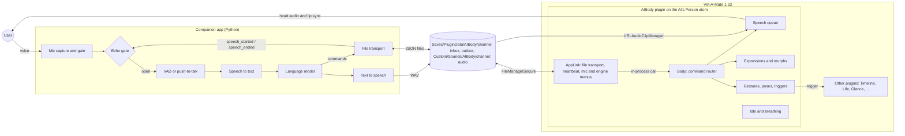

# AIBody – technical notes (English)

Former body of the README (architecture, setup details, sandbox limits, protocol summary, reuse of
other plugins). Purpose, the two-character setup and the complete settings reference are in the
German [README](../README.md).

## Load flow (the whole setup)

1. Copy `d0n.AIBody.22.var` to `<VaM>/AddonPackages/` (remove older AIBody packages, see below).
2. In VaM select the AI character's Person atom > **Plugins** tab > **Add Plugin** > choose
   `AddonPackages > d0n.AIBody.22:/Custom/Scripts/d0n/AIBody/AIBody.cslist`.
3. Start the companion app: `python -m aibody_companion --vam-root "D:\VaM"`.

That's it. The plugin's status box shows "Companion app: running ..." once both sides see each
other. Save the scene to keep the plugin and its settings with the character.

### Quick start: ask a question, hear the answer

The simplest flow, and the default: **simple Q&A** (`ai.mode` `qa`). You speak (or type in the
companion console), xAI speech to text transcribes it, Grok answers (streamed, sentence by
sentence), xAI text to speech speaks it, and the Person plays the WAV on her head audio with lip
sync. Speech only, no expressions or gestures, no proactive remarks. A few seconds of delay are normal.

1. Install the package and add the plugin to the Person (steps 1 and 2 above).
2. Start the companion app: `python -m aibody_companion --vam-root "D:\VaM"`.
3. Plugin tab *Voice* > section *Voice Mode*: paste your xAI API key from console.x.ai into the
   field **XAI API Token** (plain text; version 21). It reaches the running app within a second.
   Alternatively start the app with the key in the environment (`set XAI_API_KEY=xai-...`, Windows
   `cmd`; PowerShell: `$env:XAI_API_KEY="xai-..."`); the field wins when both are set.
   Then press **Question and Answer** (until version 20 "Simple Q&A mode"; sets AI mode `qa` and Body
   control off; scenes from 0.7.1 still have `auto`).
4. **Play test tone** (tone from the package) and **Test tone via companion** (tone through the
   app's audio folder): both must be heard.
5. Ask a question, or type `Hallo` + Enter in the companion console (same path without the mic).
   The status box shows `Last turn: Heard: ... / Answer ...` or a red error line.

Without an xAI key the same flow runs on the offline test engines ("You said: ..." with a tone)
and the status says so. If realtime is selected (`auto` / `realtime`) but not connected, or it does
not answer within 12 s after you spoke, the chain answers instead (with xAI) and the status says so;
**API Reconnect** tries realtime again.

## Architecture



Flow of one turn:

1. The companion app records the user (voice activation or push-to-talk), detects the end of the
   utterance (silence timeout) and transcribes it.
2. The language model answers with text plus an optional expression and gesture.
3. The companion app writes a WAV into `Custom/Sounds/AIBody/<channel>/` (see "Audio folder"
   below) and drops `expression`, `gesture` and `speak` commands into the channel's `inbox/`.
4. The plugin's AppLink picks them up and calls its Body directly.
5. The Body loads the clip with VaM's `URLAudioClipManager`, queues it and plays it through the
   character's head audio source. VaM's built-in lip sync moves the mouth.
6. The Body reports `speech_started` and `speech_ended` from actual playback. The companion app
   keeps the microphone closed in between (plus a short tail) so the AI does not hear and answer
   itself.

This is the same split that [Voxta](https://doc.voxta.ai/docs/integrations/vam) and
[VoiceControl2](https://github.com/StyleMavin/VoiceControl2) +
[VoskCompanion](https://github.com/StyleMavin/VoskCompanion) use: a thin client inside VaM and the
heavy work in a separate program.

Why one plugin: VaM never loads plugins from a `.var` on its own; every `.cslist` is one manual
"Add Plugin" step and compiles into one plugin slot. One `.cslist` with one MVRScript keeps the
setup to a single step and avoids any plugin-to-plugin bridge.

## Repository layout

```
src/AIBody/                the plugin (C# 6), one flat folder = what ships
  AIBody.cslist              the only entry: plain file names, no comments, no sub folders
  AIBody.cs                  AIBodyPlugin: the one MVRScript; owns AppLink + Body, status box
  AppLink.cs                 companion app link: transport, channel, heartbeat, engine menus
  FileTransport.cs           JSON files in Saves/PluginData via FileManagerSecure
  ITransport.cs              transport interface
  MicConfig.cs               microphone settings, push-to-talk, level meter (no device selection)
  Body.cs                    the character: settings, controllers, body state for heartbeats
  CommandRouter.cs           dispatches body commands, ack / error events
  SpeechPlayer.cs            speech queue: file path via URLAudioClipManager, playback, events
  MorphHelper.cs             morph lookup and smooth blending layer
  ExpressionController.cs    expression presets (built-in + expressions.json)
  PoseController.cs          poses, gestures.json, Timeline and generic triggers
  IdleController.cs          idle head sway and head gestures (nod, shake, tilt)
  BreathingController.cs     procedural breathing on a chest morph
  Diag.cs                    start-up diagnostics for the status box and the log
  Log.cs, Protocol.cs, UiHelper.cs
legacy/                    earlier plugin layouts (v0.4 Session/Person, v0.5 Client/Companion); not built
protocol/                  PROTOCOL.md and JSON schemas
companion/                 Python companion app (stdlib only for the core)
  aibody_companion/
    transport/               file transport (the only link to the plugin)
    audio/                   capture + device control, mic settings, input processor, VAD, echo gate
    pipeline/                STT, LLM, TTS interfaces, engines (offline test engines, xai.py,
                             elevenlabs.py), engine registry + fallback (engines.py)
    orchestrator.py          ties it all together (tick loop, heartbeat)
  tests/                     unit and end-to-end tests (python -m unittest)
examples/                  example commands and events, expressions.json, gestures.json
packaging/                 meta.json (shared) + AIBody.json (package overrides)
docs/BACKLOG.md            deferred features
tools/                     assemble_plugins.py (plugin folder), build_var.py (package),
                           check_plugin.sh/.py + stubs (sandbox, single-plugin and compile check)
```

## Setup

### Requirements

- Virt-A-Mate **1.22** (VaM 1.x). VaM 2 does not support plugins yet.
- Windows PC that runs VaM, Python 3.10+ for the companion app, a microphone.
- No "Allow Plugins Network Access" needed: the plugin contains no network code at all.

### Install the package

Download `d0n.AIBody.22.var` from the [releases](https://github.com/d0n/vam_plugin/releases), or
build it with `python tools/build_var.py` (writes `dist/d0n.AIBody.22.var`), and copy it to:

```
<VaM>/AddonPackages/d0n.AIBody.22.var
```

Remove all older AIBody packages from `AddonPackages`: `d0n.AIBody.1.var`, `d0n.AIBody.2.var`,
`d0n.AIBody.3.var` to `d0n.AIBody.22.var`, `d0n.AIBodySession.*.var`, `d0n.AIBodyPerson.*.var`,
`d0n.AIBodyPerson2.*.var`. Scenes saved with an older package point at that package's path, so
remove the old plugin entry from the character and add `d0n.AIBody.22` again, then save.

Contents:

```
d0n.AIBody.22.var
├── meta.json
└── Custom/Scripts/d0n/AIBody/
    ├── AIBody.cslist
    └── Log.cs, Diag.cs, Protocol.cs, UiHelper.cs, ITransport.cs, FileTransport.cs, MicConfig.cs,
        AppLink.cs, MorphHelper.cs, SpeechPlayer.cs, ExpressionController.cs,
        BreathingController.cs, IdleController.cs, PoseController.cs, CommandRouter.cs,
        Body.cs, AIBody.cs
```

Then follow the [load flow](#load-flow-the-whole-setup). If VaM asks whether to enable plugins
from this package, allow it. Keep the character's **Auto Behaviors > Lip Sync** enabled. Optional:
copy `examples/expressions.json` and `examples/gestures.json` to `<VaM>/Saves/PluginData/AIBody/`
and press **Reload expressions (expressions.json)** / **Reload poses** (tab *AI Character*).

Loose files instead of the package (handy while developing): copy `src/AIBody/` to
`<VaM>/Custom/Scripts/d0n/AIBody/` (or run
`python tools/assemble_plugins.py --out "<VaM>/Custom/Scripts/d0n/AIBody"`) and pick
`Custom/Scripts/d0n/AIBody/AIBody.cslist`. Use either the package or the loose files, not both.

### If the plugin window looks wrong (troubleshooting)

Since 0.6.2 the plugin window always starts with the status box, built before anything else. Since version 15 it is the ONE big info field (the tabs hold only controls). Since
version 16 it shows only the open tab; since version 17 it is 1800 high and the only element of the
left column (the header line above it is gone). First line: version and start result
(failures red), then the tab's info. Self test, recent events and start log are in the tab *Config*,
the connection lines (*Connection*) in *Voice*, the body lines (*Body*) in *AI Character*. It shows:

- **Info: <tab>**: help and status for the open tab (Voice: Q&A and AI mode help, key and engine
  status; AI Character: pose count; Client Character: push-to-talk help, microphone status;
  Config: config.json path, channel, result of Reload Config JSON).

- **Self-test**: Person atom yes/no, head audio (`HeadAudioSource`) found, morphs (`geometry`)
  found, pose storage (`PosePresets` with `presetBrowsePath`), pose count (and preset files found
  with `GetFiles` on `Custom/Atom/Person/Pose`), breath morph found, expression morphs x of y found
  (missing names listed), Timeline storable present for `timeline` gestures (version 13),
  `Saves/PluginData/AIBody/<channel>` writable, companion app heartbeat seen. The body checks are
  recomputed at most every 5 s and sent as `selftest` in `ready`/`heartbeat`; the companion logs
  them as `Plugin self-test: …` once per change (warning when something is missing).
- **Connection** (tab Voice) / **Body** (tab AI Character): link state, companion app, audio,
  last turn, latency / speech, expression, breath morph (the channel folder is in the tab Config).
- **Startup log**: every Init step (`ok: ...`) and every failure as
  `FEHLER in <phase>: <exception type>: <message> | at <first stack line>`.

Every phase (AppLink, Body, storables, controllers, each UI block, link start) runs on its own: a
failing phase is marked and the rest of the window still appears. Head audio, morphs and the head
controller are looked up lazily and retried every 5 s, so a missing one only disables its feature.
On an atom that is not a Person (Session/Scene Plugins, an Empty, ...) the window explains where the
plugin belongs instead of staying empty. The same lines go to the VaM log with the prefix
`AIBody:`. For a bug report send a screenshot of the plugin window plus the red `AIBody:` lines from
the error log.

### Plugin settings (tabs)

All settings (menu, `config.json`, command line) are documented in German in the [README](../README.md#4-einstellungen).

**Menu rule:** the menu shows only what can be configured. Pure path / info displays were removed in
0.7.4 (the folders are written once to the VaM log: `Settings file: ... | Expressions: ... | Gestures: ... | Audio ...`); texts that explain or
report a control (mode help, push-to-talk help, key / engine / mic status) stay. The status box shows
`Latency to first sound: X s (avg Y s, n turns)` with the breakdown (see *Latency* below).

**Sound check (no AI needed):** *Voice* > **Play test tone** plays `AIBodyTest.wav` from
the package on the head audio (no companion app involved); **Test tone via companion** lets the
app write a WAV into its audio folder and sends it like an answer. The status box shows
`Audio: Loading / Speaking: <file> / Done` or a red `Audio error: <reason>` (file missing, could not
be queued, no head audio, clip never started, speech volume 0), plus `Audio folder: <folder>` and
`Last turn: ...` (what was heard and answered, or which step failed) from the companion app.

**Audio folder:** the companion writes the speech WAVs to `Custom/Sounds/AIBody/<channel>/`,
below VaM's own folder for audio files (public plugins load audio from `Custom/` and packages; none
from `Saves/PluginData`, see [docs/API_AUDIT.md](API_AUDIT.md)). If VaM cannot load a WAV
there (the plugin reports the clip as failed), the app switches once to
`Saves/PluginData/AIBody/<channel>/audio/`, sends the same speech again from there and shows a red
note in the status box. A fixed `connection.paths.audio` in `config.json` turns the switch off.

All settings are saved with the scene and mirrored to the shared config file
`<VaM>/Saves/PluginData/AIBody/config.json` (one object per tab; see [docs/CONFIG.md](CONFIG.md)).
The companion app reads it on start. A scene without saved AIBody settings takes its values from
that file once. The file also has an `ai` section (persona, language, fallback, realtime, proactive, xAI and
ElevenLabs settings) for the companion app; the plugin sets only its tab controls in it (AI mode,
voice, proactive, voice barge-in, key file paths) and keeps the rest.

If the companion app is missing or crashes, the plugin keeps running: the status shows
"DISCONNECTED", unread files in the channel folder are kept small (old commands are dropped, at most 20
old events are kept), and the link comes back by itself as soon as the app runs again. If the app
restarted while the body was speaking, the old speech is cancelled.

Actions for triggers: *Reconnect*, *Stop speaking*, *Reset expression*, *Reload config files*,
*Push-to-talk start / stop / toggle*. Gaze is not part of AIBody yet; use
[Glance](https://hub.virtamate.com/resources/glance-realistic-head-driven-eye-motion.5461/) on the
same atom.

### Run the companion app

```
cd companion
pip install sounddevice                                   # microphone support
python -m aibody_companion --list-devices                 # diagnostics: list the input devices (the default one is used)
python -m aibody_companion --vam-root "D:\VaM"            # channel from config.json ("default")
```

Options: `--channel` (default `default`), `--no-mic` (text only), `--no-stdin`, `-v` / `--verbose`
(DEBUG for every module, turn trace always on),
`--config config.json` (see `config.example.json`, including initial `mic` settings).
`--vam-root` is required: the app and the plugin exchange JSON and audio files in
`<VaM>/Saves/PluginData/AIBody/<channel>/` (speech WAVs: `<VaM>/Custom/Sounds/AIBody/<channel>/`).
A typed line on stdin is a question like a spoken one (language model -> text to speech -> VaM),
handy for testing without a microphone. With the offline test engines
(`null` / `echo` / `tone`, no xAI key) the character answers "You said: ..." with a humming tone, enough to
test lip sync, expressions, gestures, queueing and echo gating.

### Verbose log (debugging a turn)

Switch on **Verbose log** in the plugin tab *Config* (or `"advanced": {"verbose_log": true}` in
`config.json`, or start the app with `-v`). It is applied live, no restart.

- **Companion app:** console and log file show one line per step of every turn, with a turn id and the
  seconds since the turn started: what arrived (mic audio length / level, typed text, realtime events),
  the path taken (mode, chain or realtime, fallback), speech to text (engine, time, transcript),
  the language model request (engine, model, streaming), tags dropped or sent, every sentence, text to
  speech (engine, voice, time, WAV path, length), `speak sent`, and the plugin's answer (`plugin:
  speech_started` / `speech_ended` / `error`). Example:
  `[t0003 +0.84s] stt: engine='xai' ms=812 text='Wie spät ist es?'`
- **Log file:** `<VaM>/Saves/PluginData/AIBody/logs/companion.log` (next to `config.json`), always
  written (INFO; the trace only while Verbose log is on), rotating at 1 MB, 5 old files kept
  (`companion.log.1` ... `.5`). API keys never appear: keys read from the environment or a key file,
  `Bearer ...` and anything shaped like `xai-...` / `sk-...` are replaced by `***`.
- **Plugin:** `[debug]` lines in the VaM log (command received / failed, `PlayNow`, speaking, ended)
  and the last 8 of them under *Recent events* in the status box.

### AI modes (companion app)

| `ai.mode` | what runs |
|-----------|-----------|
Plugin: tab *Voice* > **AI mode**, or *Voice* > section *Voice Mode* > **Use realtime voice**
(on = `auto`, off = `qa`).

| `qa` (default) | simple Q&A: the chain below with `xai` instead of the offline test engines when an xAI key exists, speech only (no expressions / gestures), no proactive remarks |
| `auto` | `realtime` if an xAI key exists (and TTS is not `elevenlabs`), else `chain` |
| `realtime` | Grok Voice speech-to-speech over one WebSocket (`wss://api.x.ai/v1/realtime`, `grok-voice-latest`): the mic is streamed, the server detects the end of speech, the answer audio is cut into WAV segments and spoken from the first segment on; expressions / gestures via a function tool; interrupting stops the body; reconnects with backoff, chain runs meanwhile |
| `chain` | speech to text -> language model -> text to speech, exactly the engines selected in *Voice > AI Character* (below) |

In every mode but `chain`, an xAI key replaces the offline test engines (`null` / `echo` / `tone`)
with `xai` on the chain path (typed text, the realtime fallback); the engine menus keep their values.
If realtime is connected but gives no answer within 12 s after the user spoke, the app gives it up
until **API Reconnect** (or a mode change) and the chain answers.

- **Proactive:** after 90 s of silence (`ai.proactive.idle_seconds`, tab *Voice*) the AI may say
  something by itself, or stay silent (`[silent]`, nothing is played). Needs realtime or `llm: xai`;
  paused in `qa`. `idle_seconds` 0 switches it off (`ProactiveTimer.active`; below 1 s counts as 0),
  so there is never a nudge on every tick.
- **Time context:** the AI has no clock. Each user turn and nudge carries the local date/time and
  the time since the last exchange.
- **Echo:** without echo cancellation the mic sends silence while the body talks; to interrupt by
  voice in realtime mode use headphones and switch on **Voice barge-in (headphones)**. Push-to-talk
  always interrupts.
- Details: [docs/CONFIG.md](CONFIG.md#modes-realtime-voice-and-chain).

### API key

xAI needs an **API key from [console.x.ai](https://console.x.ai)** (starts with `xai-`, API credit).
A Grok subscription (SuperGrok / X Premium) or a grok.com login token is not an API key and is
refused by `api.x.ai`. Without a key the companion warns at start and runs the offline test engines;
the key status in the info field (tab *Voice*) says which key is needed (red when the server refused it).

### Body tools (the AI moves the body)

In `auto` / `realtime` / `chain` with **Body control** on, the language model gets function tools:
`express` (expression and / or gesture from the loaded lists) and `pose` (only if poses exist).
Realtime: `function_call` -> commands to the plugin -> `function_call_output`; chain: `/v1/responses`
with `tools`, the outputs go back with `previous_response_id` (at most 3 tool-only rounds per turn).
Every call gets a result (`{"ok": true}` or `{"ok": false, "error": ...}`) so the model never waits.
Not offered in `qa` (speech only) or with Body control off; a stray call is answered `ok: false`.
There is no look-at tool: AIBody has no gaze control.

### Latency

Measured per turn from the end of your speech (VAD end, push-to-talk release, Enter in the console;
realtime: the server's `speech_stopped`) to the first sound (the plugin's `speech_started`).
Breakdown (chain): STT, LLM first token, first sentence, TTS, file write, to plugin, plugin start;
(realtime): server first audio, segment, to plugin, plugin start. One INFO line per turn in the
console / `companion.log` (`Latenz t0003 bis zum ersten Ton: 2.41 s – STT 0.80 · ...`), a trace step
in the verbose log, and the last value plus the average of the last 10 turns in the plugin status box.

### AI engines (chain mode)

One answer = speech to text -> language model -> text to speech, chosen in the plugin's
**AI** tab (or `engines` in `config.json`):

| kind | engines | key |
|------|---------|-----|
| Speech-to-text | `null` (offline, hears nothing), `xai` (`POST https://api.x.ai/v1/stt`, grok-voice-transcribe-2.0) | `XAI_API_KEY` |
| Language model | `echo` (offline test), `xai` (Grok, `POST https://api.x.ai/v1/responses`, streamed) | `XAI_API_KEY` |
| Text-to-speech | `tone` (offline test tone), `xai` (`POST https://api.x.ai/v1/tts`), `elevenlabs` (`POST https://api.elevenlabs.io/v1/text-to-speech/{voice_id}`) | `XAI_API_KEY` / `ELEVENLABS_API_KEY` |

- The answer is streamed: the first sentence is synthesized and queued on the body while the
  model is still writing. The persona goes into `instructions`; the conversation continues with
  `previous_response_id`. The model may start with a tag like `<<happy nod>>`, which becomes the
  existing `expression` / `gesture` commands.
- Every TTS engine writes 16-bit PCM WAV into the channel's `audio/` folder (VaM's audio loader
  plays WAV; WAV also gives the exact duration for the echo gate).
- **Keys:** xAI precedence (version 21): 1. the plugin field **XAI API Token** (tab Voice > Voice Mode;
  plain text, no format check; saved with the scene; sent to the app only in the `config` event as
  `keys.xai`, an empty field = no token and the next source applies), 2. the environment variable
  `XAI_API_KEY`, 3. the PATH of a key file (`ai.xai.key_file` in `config.json`). ElevenLabs has no
  menu field: `ELEVENLABS_API_KEY` or `ai.elevenlabs.key_file`. Never the key itself in `config.json`
  or the repository; every registered key is masked in the app's log and console (config events with
  `keys` are logged masked, the plugin logs only "keys masked"). The token passes through one event
  file in `Saves/PluginData/AIBody/<channel>/outbox/` which the app deletes right after reading
  (plain text on disk for that moment; the scene file holds it permanently). Without a key the engine stays selectable but shows **"not configured"** in the
  info field and the fallback (`ai.fallback`, default `null` / `echo` / `tone`) runs. A key file
  added later is picked up within 10 s; a new environment variable needs an app restart.
- If a request fails, that sentence / answer uses the fallback engine; nothing stops.
- All settings (model, voice, language, persona): [docs/CONFIG.md](CONFIG.md).

Network access exists only in the companion app. The VaM plugin still has no network code at all.

Tests and checks:

```
cd companion && python -m unittest discover -s tests -t .   # incl. end-to-end simulation (fake plugin)
python tools/check_plugin.py   # needs the .NET SDK: strict sandbox scan, single-plugin check, compile (C# 6)
python tools/build_var.py      # builds dist/d0n.AIBody.<N>.var and scans every file inside it
```

## Example scene: green screen / passthrough

`examples/scenes/AIBody_GreenScreen.json` is a VaM scene template: one Person with AIBody on its Plugins tab, Sally's scene plugin [Camera Background Color](https://hub.virtamate.com/resources/camera-background-color.24185/) (`Sally.CameraBackgroundColor.7.var`) set to #00FF00, two invisible lights, no room. The headset (e.g. Virtual Desktop chroma key on #00FF00) makes the green transparent, not VaM. Script path, class and parameter names (`Color`, `Show Skybox`) were read from the original package; the plugin switches the skybox off itself. Steps (German): [docs/SZENE_GREENSCREEN.md](SZENE_GREENSCREEN.md).

## Plugin sandbox limits

VaM compiles plugins itself (C# 6, Mono, .NET 3.5 profile) and runs them in a sandbox. A plugin
that uses a blocked API does not load at all. AIBody uses only APIs that public, working VaM
plugins use (evidence per API in [docs/API_AUDIT.md](API_AUDIT.md)); anything without such
evidence was removed, not worked around. `tools/check_plugin.py` and `tools/build_var.py` enforce
it with a strict scan of every file in `src/` and in the built `.var` (code, comments and strings):
zero matches for `UnityWebRequest`, `UnityEngine.Networking`, `WWW`, `System.IO`, `System.Net`,
sockets, `Process`, `System.Diagnostics`, reflection, `Assembly.Load`, `DllImport`, the Unity
microphone API and `OpenURL`. The compile stubs in `tools/stubs` declare only the evidenced VaM
members, so using anything else fails the compile.

- **The stub compile is not VaM's compiler.** It uses Roslyn; VaM uses an old Mono `mcs`. Version 13
  passed the stub compile but failed in VaM with `CS584: Internal compiler error: Unexpected error
  when loading type 'System.Collections.Generic.Dictionary<TKey,TValue>.ValueCollection.Enumerator'`
  for a `foreach` over a dictionary's values (`ExpressionController.cs`, getter at line 40).
  Rule since version 14: never `foreach` or LINQ over `dict.Keys` / `dict.Values`; iterate the
  dictionary itself with `KeyValuePair` (as `MorphHelper` has done since the first version) or copy
  with `new List<T>(dict.Keys)`. The strict scan (`tools/sandbox_rules.py`) rejects these constructs
  and the `KeyCollection` / `ValueCollection` types; `companion/tests/test_vam_compiler_rules.py`
  pins the rule.

- **No `System.IO`.** File access goes through `MVR.FileManagementSecure.FileManagerSecure`.
  Writing is limited to `Saves/PluginData`. There is no reliable rename, so the plugin writes
  event files in place and the companion app tolerates partial files.
- **No native DLLs, no `System.Diagnostics.Process`, no reflection.** The plugin cannot start the
  companion app or load speech engines. That is why the brain is a separate app.
- **No network code at all** (no `UnityEngine.Networking`, no `UnityWebRequest`, no `WWW`). The
  companion app link is the shared folder; speech audio is loaded from a local file path with
  VaM's own `URLAudioClipManager` and played with the head `AudioSourceControl` (the Dollmaster /
  FreeMMD pattern).
- **C# 6 only.** No tuples, `out var`, pattern matching or other C# 7+ features.
- **One MVRScript per `.cslist`**, flat file list (sub folder paths inside a `.var` are
  unverified).
- **No microphone API in the plugin.** Capture lives in the companion app, always from the system
  default input (no device selection, no device list); the plugin only sends settings and
  push-to-talk as files and shows the state the app reports.

### API audit (v0.6.1)

Kept, each with a public plugin that uses it (links in [docs/API_AUDIT.md](API_AUDIT.md)):
`FileManagerSecure` (CreateDirectory, FileExists, ReadAllText, WriteAllText, DeleteFile,
GetFiles(dir)); `URLAudioClipManager` (QueueClip after `NormalizeMediaPath`, GetClip, RemoveClip);
the `HeadAudioSource` `AudioSourceControl` (PlayNow, Stop, volume, audioSource); morphs via
`geometry` > `DAZCharacterSelector.morphsControlUI` > GetMorphByDisplayName / GetMorphByUid;
`headControl` rotation; Timeline via `GetStorableIDs` + `CallAction("Play <name>")`; pose presets via
`presetBrowsePath` + `NormalizePath` + `CallAction("LoadPreset")`; generic triggers via CallAction
and Get*JSONParam; the standard MVRScript UI.

Removed: the optional HTTP transport and `--http` build, the `speak.url` field, the transport
chooser, the companion app's HTTP/auto modes, the clip readiness check (`clipToPlay`), action-name
lookup before `CallAction`, the `GetFiles` search pattern, the direct `AudioSource.Play` fallback.

## Protocol summary

Full spec: [protocol/PROTOCOL.md](../protocol/PROTOCOL.md) (version 3). Every message is a JSON
object with `v`, `type`, `id` and `ts`.

Companion app to VaM: body commands `speak`, `stop_speaking`, `expression`, `set_morphs`,
`reset_morphs`, `gesture`, `pose`, `trigger`, `idle`, `breathing`; `ping`,
`companion_heartbeat`, and for the microphone settings `config_ack`, `mic_state`,
`mic_level`.

VaM to companion app: `ready`, `heartbeat`, `pong` (with the body's state), `config`, `ptt`,
`shutdown`, `speech_started`, `speech_ended`, `gesture_done`, `ack`, `error`.

Example:

```json
{ "v": 3, "type": "speak", "id": "utt-0001",
  "audio": "Custom/Sounds/AIBody/default/utt-0001.wav",
  "text": "Hello, nice to meet you!", "expression": "happy", "queue": "append" }
```

### Earlier versions

v0.2 shipped one plugin (`d0n.AIBody.1.var`), v0.3/v0.4 a Session plugin plus Person/Person2
plugins with character slots (protocol v1), v0.5 a Client and a Companion plugin in
`d0n.AIBody.2.var` (protocol v2), v0.6.0 the same single plugin as now in `d0n.AIBody.3.var`
(still with an optional HTTP build, removed in 0.6.1). The older sources are kept in [legacy/](../legacy/) for reference; use
the tags `v0.4.0-session` or `v0.5.0` for a buildable tree.

## Reusing other plugins

AIBody keeps its own motion simple and is meant to work alongside established plugins on the same
atom. The `trigger` command and `gestures.json` (`kind: timeline` or `trigger`) can call actions and
set parameters on any of them.

| Plugin | Use for | Link |
|--------|---------|------|
| Timeline (Acid Bubbles) | keyframe animations for gestures and idle loops; "Play &lt;name&gt;" actions | [Hub](https://hub.virtamate.com/resources/timeline.94/), [wiki](https://hub.virtamate.com/resources/timeline-3-wiki.860/), [GitHub](https://github.com/acidbubbles/vam-timeline) |
| Life (MacGruber) | realistic breathing with chest movement and sounds, Gaze head motion | [Hub](https://hub.virtamate.com/resources/life.165/) |
| Glance (Acid Bubbles) | natural eye movement driven by head motion | [Hub](https://hub.virtamate.com/resources/glance-realistic-head-driven-eye-motion.5461/), [GitHub](https://github.com/acidbubbles/vam-glance) |
| E-Motion (VRAdultFun) | expressions and idle reactions from personality presets | VaMHub, search "E-Motion" |
| Naturalis (everlaster) | breast and glute physics | VaMHub, search "Naturalis" |
| Voxta (Acid Bubbles) | reference for the thin-client design, state triggers, echo handling | [docs](https://doc.voxta.ai/docs/integrations/vam) |
| VoiceControl2 + VoskCompanion | reference for a plugin talking to an external speech app | [plugin](https://github.com/StyleMavin/VoiceControl2), [companion](https://github.com/StyleMavin/VoskCompanion) |
| SpeechRecognition | in-VaM Windows speech recognition (legacy, breaks with Windows updates) | VaMHub |
| Embody, Dev Tools (Acid Bubbles) | code to study for VaM plugin patterns | [Embody](https://github.com/acidbubbles/vam-embody), [Dev Tools](https://github.com/acidbubbles/vam-devtools) |

Poses from VaMHub can be loaded with the `pose` command using the usual package path, for example
`Author.Package.1:/Custom/Atom/Person/Pose/name.vap`.

## Roadmap

1. **Test inside VaM 1.22** and fix every `TODO(verify)` in `src/AIBody/`: that the plugin loads
   from the `.var` in the sandbox, `FileManagerSecure.GetFiles` paths, `URLAudioClipManager`
   loading of a `Saves/PluginData` path and `PlayNow` playback (lip sync, start detection), the
   `PosePresets` storable, editable text fields, chooser updates, morph names (breath morph).
2. **Real engines** in the companion app (STT, LLM, TTS), streamed sentence by sentence.
3. Everything else is parked in [docs/BACKLOG.md](BACKLOG.md) (German, deferred ideas).

Agreed spec: [docs/SPEC.md](SPEC.md); status done / open: [docs/ANFORDERUNGEN.md](ANFORDERUNGEN.md).

### Microphone diagnostics without VaM

`python tools/mic_test.py` prints every PortAudio device raw, the input devices per host API and the
input devices of the default host API (`list_input_devices`, the same list as `--list-devices`), and
writes `mic_test_output.txt`. Diagnostics only: the companion app always records from the system
default input (`sounddevice` default, `MicCapture` opens `device=None`), there is no device menu and
no `devices`/`list_devices` message since 19.11.2026. An old `mic.device` in config.json, a `config`
event or a saved scene, and an old plugin's `list_devices` event are ignored quietly
(`audio/mic_settings.py` `RETIRED`, `protocol.RETIRED_EVENTS`).

